# דוח הפרויקט — שלב ב׳: שאילתות ואילוצים

## שער

**מיני פרויקט בבסיסי נתונים — שלב ב׳**

| מגישה | תעודת זהות |
|---|---|
| נועה מנוסה | 216217489 |
| מוריה כדורי | 326335387 |

- **המערכת:** מערכת לניהול מעבדה בבית חולים (Hospital Laboratory Information System)
- **היחידה הנבחרת:** מחלקת בדיקות ומעבדה בבית חולים
- **מסד הנתונים:** PostgreSQL 16, ניהול ב־pgAdmin 4
- **תג ההגשה בגיט:** `stage-b-final`
- **דוח שלב א׳:** [README הראשי של המאגר](../../README.md)

## תוכן עניינים

1. [מבוא וקובצי ההגשה](#1-מבוא-וקובצי-ההגשה)
2. [שינויים בבסיס הנתונים ותרשימים מעודכנים](#2-שינויים-בבסיס-הנתונים-ותרשימים-מעודכנים)
3. [שאילתות SELECT בשתי צורות (Q1–Q4)](#3-שאילתות-select-בשתי-צורות-q1q4)
4. [שאילתות SELECT נוספות (Q5–Q8)](#4-שאילתות-select-נוספות-q5q8)
5. [שאילתות DELETE](#5-שאילתות-delete)
6. [שאילתות UPDATE](#6-שאילתות-update)
7. [ROLLBACK ו־COMMIT](#7-rollback-וcommit)
8. [אילוצים](#8-אילוצים)
9. [אינדקסים](#9-אינדקסים)
10. [גיבוי backup2 ושחזור](#10-גיבוי-backup2-ושחזור)
11. [סדר הרצת הקבצים](#11-סדר-הרצת-הקבצים)

## 1. מבוא וקובצי ההגשה

בשלב זה תשאלנו את בסיס הנתונים שנבנה ואוכלס בשלב א׳: שמונה טבלאות ו־66,657 רשומות. כתבנו שאילתות SELECT, DELETE ו־UPDATE, הדגמנו ROLLBACK ו־COMMIT, הוספנו שלושה אילוצים ושלושה אינדקסים, ויצרנו גיבוי מעודכן.

| קובץ | תוכן |
|---|---|
| [Queries.sql](Queries.sql) | 8 שאילתות SELECT (ארבע מהן בשתי צורות, ובסך הכול 12 מימושים), 3 שאילתות DELETE ו־3 שאילתות UPDATE |
| [Constraints.sql](Constraints.sql) | שלושה אילוצים חדשים ב־ALTER TABLE, ושלוש הכנסות שסותרות אותם |
| [RollbackCommit.sql](RollbackCommit.sql) | הדגמת ROLLBACK והדגמת COMMIT |
| [Index.sql](Index.sql) | שלושה אינדקסים, עם מדידת זמן ריצה לפני ואחרי כל אחד |
| [backup2.dump](backup2.dump) | גיבוי מעודכן של בסיס הנתונים |
| [StageA_Migration.sql](StageA_Migration.sql) | שינוי מבנה הטבלה LABTECHNICIAN באמצעות ALTER TABLE (סעיף 2) |
| [PartnerValidation.sql](PartnerValidation.sql) | בדיקת תקינות אחרי שחזור הגיבוי |
| [screenshots](screenshots/) | צילומי המסך מ־pgAdmin ([נספח כל הצילומים](screenshots/README.md)) |
| [diagrams](diagrams/) | ERD ו־DSD מעודכנים וקובצי המקור של ERDPlus |
| [audit](audit/) | יומני הרצה, תוכניות ביצוע (EXPLAIN) ומדידות זמנים |

### התאמת השאילתות למסכי המערכת

השאילתות נכתבו עבור ארבעת המסכים שהוגדרו בשלב א׳, כדי שאפשר יהיה לחבר אותן לממשק בשלב הסופי. כל שאילתה מחזירה יותר משתי עמודות, ובהן שמות ולא רק מזהים.

| מסך | שאילתות |
|---|---|
| ניהול מטופלים | Q3 — התוצאה האחרונה של כל מטופל |
| הזמנת בדיקות | Q1 — עומס חודשי לרופא · Q5 — פילוח הזמנות לפי תאריך ועדיפות · D3 · U1 |
| ניהול בדיקות מעבדה | Q4 — סוגי בדיקות עמוסים · Q6 — תוקף הסמכת טכנאים · Q7 — תור הזמנות ממתינות · D2 · U3 |
| תוצאות והתראות | Q2 — מטופלים עם התראות פתוחות · Q8 — חריגות לפי רופא וקטגוריה · D1 · U2 |

## 2. שינויים בבסיס הנתונים ותרשימים מעודכנים

בעקבות דרישת המרצה לשני מאפיינים משמעותיים מסוג DATE, הוספנו לטבלה LABTECHNICIAN את העמודה **CertificationExpiresOn** — תאריך תוקף ההסמכה של עובד המעבדה. השדה השני מסוג DATE הוא PATIENT.DateOfBirth. השינוי בוצע בפקודת ALTER TABLE:

```sql
BEGIN;
ALTER TABLE labtechnician ADD COLUMN certificationexpireson DATE;
UPDATE labtechnician
SET certificationexpireson = DATE '2026-01-01' + (365 + technicianid % 730);
ALTER TABLE labtechnician ALTER COLUMN certificationexpireson SET NOT NULL;
COMMIT;
```

העמודה החדשה משמשת בשאילתה Q6 ובעדכון U3. גם קובצי האכלוס של שלב א׳ עודכנו כך שיכניסו אותה; הפירוט נמצא ב־[StageAChanges.md](StageAChanges.md). השינוי שומר על 3NF, כי תאריך התוקף תלוי רק במפתח הטכנאי.

תרשימי ה־ERD וה־DSD עודכנו בהתאם (השדות מסוג DATE מסומנים בירוק). התמונות הופקו מקובצי המקור של ERDPlus שבתיקייה [diagrams](diagrams/): [ERD-revised.erdplus](diagrams/ERD-revised.erdplus) ו־[DSD-stage-b-verified.erdplus](diagrams/DSD-stage-b-verified.erdplus).

### ERD מעודכן


### DSD מעודכן


## 3. שאילתות SELECT בשתי צורות (Q1–Q4)

כל שאילתה נכתבה בשתי צורות שמחזירות בדיוק אותה תוצאה. השוויון נבדק ב־EXCEPT ALL בשני הכיוונים ([יומן הבדיקה](audit/04_equivalence.txt)). זמני הריצה נמדדו ב־EXPLAIN ANALYZE על אותו בסיס נתונים, ותוכניות הביצוע המלאות שמורות בתיקייה [audit](audit/) (Q1A_plan.txt וכן הלאה). בצילומי התוצאה מוצגות עד חמש שורות.

| זוג | צורה A (ms) | צורה B (ms) | היעילה יותר |
|---|---:|---:|---|
| Q1 | 23.784 | 5,024.153 | A — פי 200 בערך |
| Q2 | 11.944 | 19,496.062 | A — פי 1,600 בערך |
| Q3 | 37.841 | 40.125 | A — מעט |
| Q4 | 30.692 | 31.239 | שקולות בפועל |

### Q1 — עומס בדיקות חודשי לכל רופא

**תיאור:** לכל רופא ולכל חודש (שנה וחודש מתוך מועד ההזמנה) מוצג מספר הבדיקות שהרופא הזמין, וכמה מהן הושלמו. השאילתה מצרפת את DOCTOR, ‏TESTORDER ו־LABTEST, מפרקת את התאריך לשנה ולחודש, מקבצת ב־GROUP BY וממיינת ב־ORDER BY. 600 שורות. המסך: הזמנת בדיקות.

**צורה A** — צירוף שלוש הטבלאות וקיבוץ אחד ב־GROUP BY.

```sql
SELECT d.doctorid, d.firstname, d.lastname,
       EXTRACT(YEAR FROM o.orderedat)::int AS order_year,
       EXTRACT(MONTH FROM o.orderedat)::int AS order_month,
       COUNT(*) AS test_count,
       COUNT(*) FILTER (WHERE l.status='Completed') AS completed_count
FROM doctor d JOIN testorder o USING(doctorid) JOIN labtest l USING(orderid)
GROUP BY d.doctorid, EXTRACT(YEAR FROM o.orderedat), EXTRACT(MONTH FROM o.orderedat)
ORDER BY order_year, order_month, d.doctorid;
```

| צילום הרצה | צילום תוצאה |
|---|---|
| 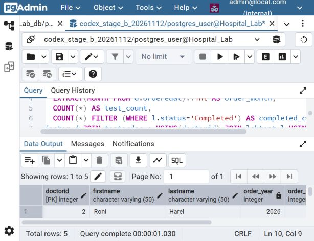 | 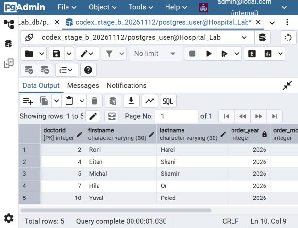 |

**צורה B** — CTE שמחשב את צירופי רופא־חודש, ושתי תתי־שאילתות מתואמות שסופרות לכל שורה.

```sql
WITH months AS (
 SELECT DISTINCT d.doctorid, d.firstname, d.lastname,
        EXTRACT(YEAR FROM o.orderedat)::int AS order_year,
        EXTRACT(MONTH FROM o.orderedat)::int AS order_month
 FROM doctor d JOIN testorder o USING(doctorid) JOIN labtest l USING(orderid)
)
SELECT m.*,
 (SELECT COUNT(*) FROM testorder o JOIN labtest l USING(orderid)
  WHERE o.doctorid=m.doctorid AND EXTRACT(YEAR FROM o.orderedat)=m.order_year
    AND EXTRACT(MONTH FROM o.orderedat)=m.order_month) AS test_count,
 (SELECT COUNT(*) FROM testorder o JOIN labtest l USING(orderid)
  WHERE o.doctorid=m.doctorid AND EXTRACT(YEAR FROM o.orderedat)=m.order_year
    AND EXTRACT(MONTH FROM o.orderedat)=m.order_month
    AND l.status='Completed') AS completed_count
FROM months m ORDER BY order_year, order_month, doctorid;
```

| צילום הרצה | צילום תוצאה |
|---|---|
|  | 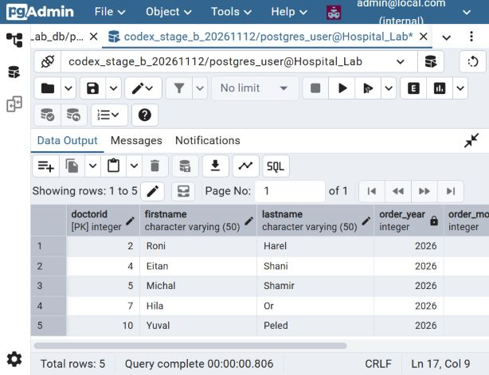 |

**ההבדל ביעילות:** **צורה A יעילה יותר בהרבה** (23.8 ms לעומת 5,024 ms). צורה A עוברת פעם אחת על 30,000 הבדיקות ומקבצת אותן. בצורה B כל אחת משתי תתי־השאילתות רצה 600 פעמים, פעם לכל שורת רופא־חודש. בכל ריצה היא סורקת מחדש את LABTEST ואת TESTORDER ומחשבת EXTRACT על כל שורה, ולכן אי אפשר להיעזר באינדקס. בתוכנית הביצוע זה נראה כ־SubPlan עם ‎loops=600.

### Q2 — מטופלים עם שתי התראות פתוחות או יותר

**תיאור:** לכל מטופל מוצג מספר ההתראות הפתוחות שלו, וכמה מהן בחומרה High או Critical. מוצגים רק מטופלים עם שתי התראות פתוחות לפחות, ממוינים מהרב אל המעט. השאילתה מצרפת חמש טבלאות: PATIENT, ‏TESTORDER, ‏LABTEST, ‏TESTRESULT ו־LABALERT. 327 שורות. המסך: תוצאות והתראות.

**צורה A** — סינון ההתראות הפתוחות, צירוף, GROUP BY ו־HAVING.

```sql
SELECT p.patientid, p.firstname, p.lastname, COUNT(*) AS open_alerts,
       COUNT(*) FILTER (WHERE a.severity IN ('High','Critical')) AS high_alerts
FROM patient p JOIN testorder o USING(patientid) JOIN labtest l USING(orderid)
JOIN testresult r USING(labtestid) JOIN labalert a USING(resultid)
WHERE a.status='Open'
GROUP BY p.patientid HAVING COUNT(*)>=2
ORDER BY open_alerts DESC, p.patientid;
```

| צילום הרצה | צילום תוצאה |
|---|---|
| 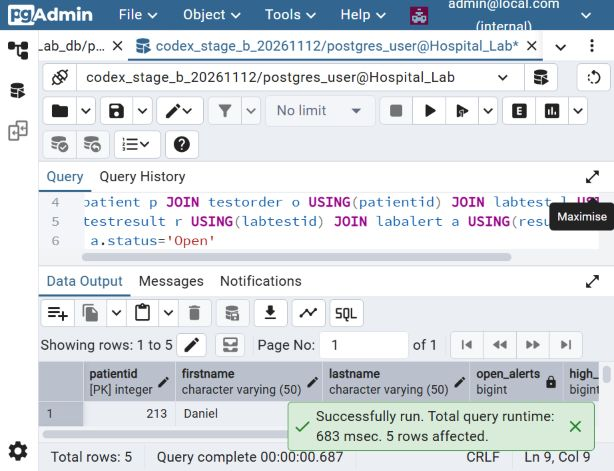 | 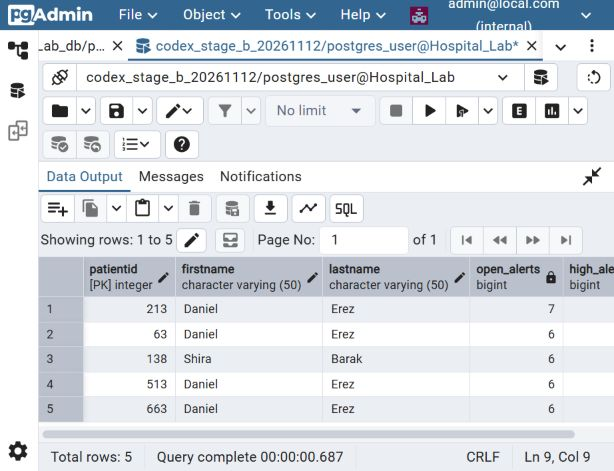 |

**צורה B** — לכל מטופל תתי־שאילתות מתואמות שסופרות את ההתראות, וסינון בשאילתה החיצונית.

```sql
WITH totals AS (
 SELECT p.patientid, p.firstname, p.lastname,
 (SELECT COUNT(*) FROM testorder o JOIN labtest l USING(orderid)
  JOIN testresult r USING(labtestid) JOIN labalert a USING(resultid)
  WHERE o.patientid=p.patientid AND a.status='Open') AS open_alerts,
 (SELECT COUNT(*) FROM testorder o JOIN labtest l USING(orderid)
  JOIN testresult r USING(labtestid) JOIN labalert a USING(resultid)
  WHERE o.patientid=p.patientid AND a.status='Open'
    AND a.severity IN ('High','Critical')) AS high_alerts
 FROM patient p
)
SELECT * FROM totals WHERE open_alerts>=2 ORDER BY open_alerts DESC, patientid;
```

| צילום הרצה | צילום תוצאה |
|---|---|
| 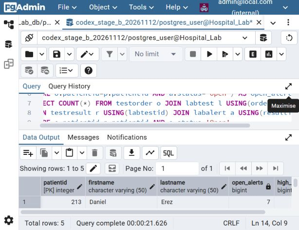 |  |

**ההבדל ביעילות:** **צורה A יעילה יותר בהרבה** (11.9 ms לעומת 19,496 ms). צורה A מסננת קודם את ההתראות הפתוחות, שהן קבוצה קטנה, ומקבצת פעם אחת. צורה B מריצה את תתי־השאילתות לכל אחד מ־3,000 המטופלים, גם למטופלים שאין להם התראות כלל, וכל הרצה מצרפת מחדש ארבע טבלאות (‎loops=3000 בתוכנית). תת־השאילתה הראשונה מחושבת פעם נוספת גם לצורך הסינון.

### Q3 — התוצאה האחרונה של כל מטופל

**תיאור:** לכל מטופל מוצגת תוצאת הבדיקה האחרונה שלו: שם הבדיקה, הערך, המועד וסימון החריגה. אם יש שתי תוצאות באותו מועד, נבחרת זו עם ResultID הגבוה יותר. השאילתה מצרפת חמש טבלאות. 3,000 שורות. המסך: ניהול מטופלים (תיק מטופל).

**צורה A** — פונקציית חלון ROW_NUMBER לפי מטופל, ובחירת השורה הראשונה.

```sql
WITH ranked AS (
 SELECT p.patientid, p.firstname, p.lastname, tt.testname,
        r.resultid, r.resultedat, r.numericvalue, r.textvalue, r.isabnormal,
        ROW_NUMBER() OVER (PARTITION BY p.patientid
                          ORDER BY r.resultedat DESC, r.resultid DESC) AS rn
 FROM patient p JOIN testorder o USING(patientid) JOIN labtest l USING(orderid)
 JOIN testtype tt USING(testtypeid) JOIN testresult r USING(labtestid)
)
SELECT patientid, firstname, lastname, testname, resultid, resultedat,
       numericvalue, textvalue, isabnormal
FROM ranked WHERE rn=1 ORDER BY patientid;
```

| צילום הרצה | צילום תוצאה |
|---|---|
|  | 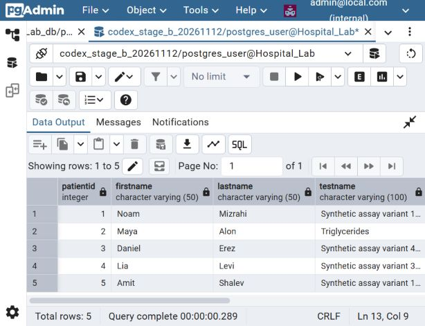 |

**צורה B** — NOT EXISTS: נבחרת תוצאה רק אם לאותו מטופל אין תוצאה מאוחרת ממנה.

```sql
SELECT p.patientid, p.firstname, p.lastname, tt.testname,
       r.resultid, r.resultedat, r.numericvalue, r.textvalue, r.isabnormal
FROM patient p JOIN testorder o USING(patientid) JOIN labtest l USING(orderid)
JOIN testtype tt USING(testtypeid) JOIN testresult r USING(labtestid)
WHERE NOT EXISTS (
 SELECT 1 FROM testorder o2 JOIN labtest l2 USING(orderid)
 JOIN testresult r2 USING(labtestid)
 WHERE o2.patientid=p.patientid
   AND (r2.resultedat,r2.resultid)>(r.resultedat,r.resultid)
)
ORDER BY p.patientid;
```

| צילום הרצה | צילום תוצאה |
|---|---|
| 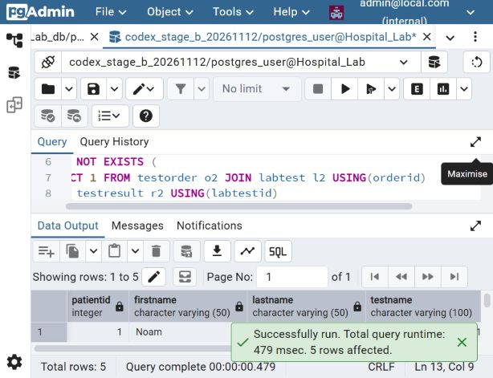 | 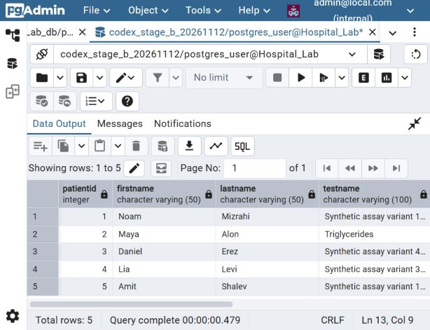 |

**ההבדל ביעילות:** **צורה A יעילה מעט יותר** (37.8 ms לעומת 40.1 ms). צורה A ממיינת את התוצאות לפי מטופל ומועד, ועוברת עליהן פעם אחת (WindowAgg). בצורה B המתכנן הופך את NOT EXISTS ל־Hash Anti Join, ולכן ההפרש קטן. ובכל זאת, B משווה כל תוצאה לכל שאר התוצאות של אותו מטופל, כך שהעבודה גדלה בריבוע מספר התוצאות למטופל. לכן A עדיפה, וככל שיצטברו תוצאות היתרון שלה יגדל.

### Q4 — סוגי בדיקות שעומסם מעל הממוצע

**תיאור:** לכל סוג בדיקה מוצג מספר הבדיקות שבוצעו ממנו ומספר המטופלים השונים. מוצגים רק סוגים שמספר הבדיקות שלהם גבוה מהממוצע בקטלוג. LEFT JOIN מבטיח שגם סוגים ללא בדיקות ייכללו בחישוב הממוצע. 20 שורות. המסך: ניהול בדיקות מעבדה (תכנון משאבים).

**צורה A** — CTE ותת־שאילתה שמחשבת את הממוצע.

```sql
WITH counts AS (
 SELECT tt.testtypeid, tt.testname, tt.category, COUNT(l.labtestid) AS test_count,
        COUNT(DISTINCT o.patientid) AS patient_count
 FROM testtype tt LEFT JOIN labtest l USING(testtypeid)
 LEFT JOIN testorder o USING(orderid)
 GROUP BY tt.testtypeid
)
SELECT * FROM counts WHERE test_count>(SELECT AVG(test_count) FROM counts)
ORDER BY test_count DESC, testtypeid;
```

| צילום הרצה | צילום תוצאה |
|---|---|
| 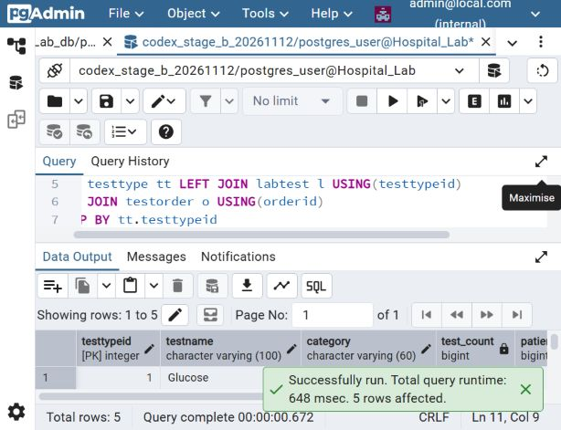 |  |

**צורה B** — פונקציית חלון AVG(COUNT(...)) OVER ()‎ באותו מעבר.

```sql
WITH counts AS (
 SELECT tt.testtypeid, tt.testname, tt.category, COUNT(l.labtestid) AS test_count,
        COUNT(DISTINCT o.patientid) AS patient_count,
        AVG(COUNT(l.labtestid)) OVER () AS mean_count
 FROM testtype tt LEFT JOIN labtest l USING(testtypeid)
 LEFT JOIN testorder o USING(orderid)
 GROUP BY tt.testtypeid
)
SELECT testtypeid,testname,category,test_count,patient_count FROM counts
WHERE test_count>mean_count ORDER BY test_count DESC,testtypeid;
```

| צילום הרצה | צילום תוצאה |
|---|---|
|  | 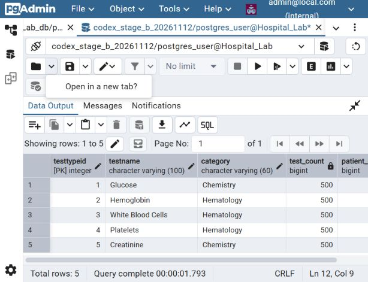 |

**ההבדל ביעילות:** **שתי הצורות שקולות בפועל** (30.7 ms לעומת 31.2 ms). בשתיהן אותן סריקות, אותו מיון ואותם 464 Buffers, והפרש של פחות מ־2% הוא בתחום רעש המדידה. מבחינה תאורטית B יעילה מעט יותר: היא מחשבת את הממוצע ב־WindowAgg באותו מעבר, בעוד A סורקת את ה־CTE פעמיים, פעם לחישוב הממוצע ופעם לסינון. לכן העלות המוערכת של B נמוכה במעט.

## 4. שאילתות SELECT נוספות (Q5–Q8)

### Q5 — פילוח הזמנות לפי יום, חודש, שנה ועדיפות

**תיאור:** לכל יום (שנה, חודש ויום מתוך מועד ההזמנה) ולכל רמת עדיפות מוצגים מספר ההזמנות, מספר המטופלים השונים ומספר הרופאים השונים. השאילתה מפרקת את התאריך ליום, חודש ושנה. 588 שורות. המסך: הזמנת בדיקות (תמונת עומס).

```sql
SELECT EXTRACT(YEAR FROM o.orderedat)::int AS order_year,
       EXTRACT(MONTH FROM o.orderedat)::int AS order_month,
       EXTRACT(DAY FROM o.orderedat)::int AS order_day, o.priority,
       COUNT(DISTINCT o.orderid) AS order_count,
       COUNT(DISTINCT p.patientid) AS patient_count,
       COUNT(DISTINCT d.doctorid) AS doctor_count
FROM testorder o JOIN patient p USING(patientid) JOIN doctor d USING(doctorid)
GROUP BY 1,2,3,o.priority ORDER BY 1,2,3,o.priority;
```

| צילום הרצה | צילום תוצאה |
|---|---|
| 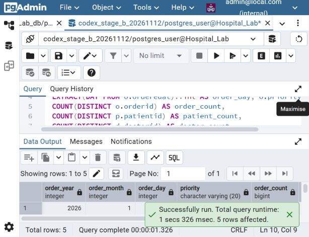 |  |

### Q6 — תוקף הסמכת טכנאים ועומס עבודה

**תיאור:** מוצגים הטכנאים שתוקף ההסמכה שלהם מסתיים עד 450 יום אחרי תאריך הייחוס 12.11.2026, כולל הסמכות שכבר פגו. לכל טכנאי מוצגים תאריך התוקף, השנה והחודש שלו, מספר הימים שנותרו, מספר הבדיקות שהוקצו לו ומספר המטופלים. השאילתה משתמשת בשדה ה־DATE החדש ובחשבון תאריכים. 400 שורות. המסך: ניהול בדיקות מעבדה (שיוך טכנאים).

```sql
SELECT t.technicianid,t.firstname,t.lastname,t.certificationexpireson,
       EXTRACT(YEAR FROM t.certificationexpireson)::int AS expiry_year,
       EXTRACT(MONTH FROM t.certificationexpireson)::int AS expiry_month,
       t.certificationexpireson-DATE '2026-11-12' AS days_until_expiry,
       COUNT(l.labtestid) AS assigned_tests,
       COUNT(DISTINCT o.patientid) AS patients
FROM labtechnician t LEFT JOIN labtest l USING(technicianid)
LEFT JOIN testorder o USING(orderid)
WHERE t.certificationexpireson<=DATE '2026-11-12'+450
GROUP BY t.technicianid ORDER BY t.certificationexpireson,t.technicianid;
```

| צילום הרצה | צילום תוצאה |
|---|---|
|  |  |

### Q7 — תור הזמנות עם בדיקות ממתינות

**תיאור:** מוצגות ההזמנות שיש בהן בדיקות במצב Scheduled או InProgress, ושמספר הבדיקות הממתינות בהן גבוה מהממוצע או שווה לו. לכל הזמנה מוצגים שם המטופל, שם הרופא, העדיפות ומועד ההזמנה. השאילתה משתמשת ב־CTE ובתת־שאילתה עם AVG. 1,000 שורות. המסך: ניהול בדיקות מעבדה (תור עבודה).

```sql
WITH pending AS (
 SELECT o.orderid,p.firstname,p.lastname,d.firstname AS doctor_firstname,
        d.lastname AS doctor_lastname,o.priority,o.orderedat,
        COUNT(*) AS pending_tests
 FROM testorder o JOIN patient p USING(patientid) JOIN doctor d USING(doctorid)
 JOIN labtest l USING(orderid)
 WHERE l.status IN ('Scheduled','InProgress')
 GROUP BY o.orderid,p.patientid,d.doctorid
)
SELECT * FROM pending WHERE pending_tests>=(SELECT AVG(pending_tests) FROM pending)
ORDER BY pending_tests DESC,orderedat,orderid;
```

| צילום הרצה | צילום תוצאה |
|---|---|
|  |  |

### Q8 — תוצאות חריגות לפי רופא וקטגוריית בדיקה

**תיאור:** לכל רופא ולכל קטגוריית בדיקה מוצגים מספר התוצאות החריגות שיש להן התראה פתוחה, מספר המטופלים השונים ומועד התוצאה החריגה האחרונה. מוצגים רק צירופים עם שתי תוצאות כאלה לפחות. EXISTS מונע ספירה כפולה של תוצאה שיש לה כמה התראות. 234 שורות. המסך: תוצאות והתראות.

```sql
SELECT d.doctorid,d.firstname,d.lastname,tt.category,
       COUNT(*) AS abnormal_results,
       COUNT(DISTINCT o.patientid) AS patients,
       MAX(r.resultedat) AS latest_abnormal
FROM doctor d JOIN testorder o USING(doctorid) JOIN labtest l USING(orderid)
JOIN testtype tt USING(testtypeid) JOIN testresult r USING(labtestid)
WHERE r.isabnormal AND EXISTS (
 SELECT 1 FROM labalert a WHERE a.resultid=r.resultid AND a.status='Open'
)
GROUP BY d.doctorid,tt.category HAVING COUNT(*)>=2
ORDER BY abnormal_results DESC,d.doctorid,tt.category;
```

| צילום הרצה | צילום תוצאה |
|---|---|
|  | 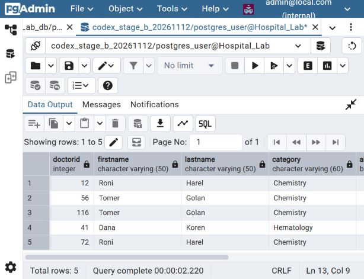 |

## 5. שאילתות DELETE

כל פקודת שינוי הורצה בתוך טרנזקציה (BEGIN, הפקודה ואז ROLLBACK), כדי שמספר הרשומות באכלוס לא ירד. כך גם מופיע בקובץ Queries.sql. עבור כל פקודה צולמו שלושה שלבים:

- **לפני** — הרשומות שעומדות להימחק או להתעדכן;
- **הרצה** — הפקודה עם RETURNING, שמציג את הרשומות שהושפעו;
- **אחרי** — אותן רשומות, עוד באותה טרנזקציה ולפני ה־ROLLBACK.

בצילומי ה"אחרי" של המחיקות, הערך NULL בעמודות מראה שהרשומה כבר אינה קיימת בטבלה.

### D1 — מחיקת התראות ישנות שכבר טופלו

**תיאור:** נמחקות התראות במצב Acknowledged או Resolved שאושרו לפני 1.7.2026, ורק אם הבדיקה הושלמה ויש לה תוצאה. השאילתה מצרפת את LABALERT, ‏TESTRESULT ו־LABTEST. נמחקו 1,152 שורות. המסך: תוצאות והתראות.

```sql
DELETE FROM labalert a USING testresult r,labtest l
WHERE a.resultid=r.resultid AND r.labtestid=l.labtestid
  AND a.status IN ('Acknowledged','Resolved')
  AND a.acknowledgedat<TIMESTAMP '2026-07-01' AND l.status='Completed'
RETURNING a.alertid,a.resultid,a.status,a.acknowledgedat;
```

| לפני | הרצה | אחרי |
|---|---|---|
|  | 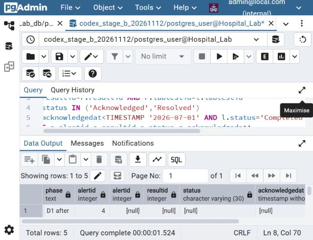 |  |

### D2 — מחיקת בדיקות מתוכננות ישנות שאין להן תוצאה

**תיאור:** נמחקות בדיקות במצב Scheduled, מהזמנות שנפתחו לפני 1.4.2026, שאין להן תוצאה. נמחקת רק בדיקה שיש בהזמנה שלה בדיקה נוספת שאינה מתוכננת, כדי שההזמנה לא תישאר ריקה. השאילתה משתמשת ב־NOT EXISTS וב־EXISTS. נמחקו 918 שורות. המסך: ניהול בדיקות מעבדה.

```sql
DELETE FROM labtest l USING testorder o
WHERE l.orderid=o.orderid AND l.status='Scheduled'
  AND o.orderedat<TIMESTAMP '2026-04-01'
  AND NOT EXISTS (SELECT 1 FROM testresult r WHERE r.labtestid=l.labtestid)
  AND EXISTS (SELECT 1 FROM labtest other
              WHERE other.orderid=l.orderid AND other.labtestid<>l.labtestid
                AND other.status<>'Scheduled')
RETURNING l.labtestid,l.orderid,l.status,l.scheduledat;
```

| לפני | הרצה | אחרי |
|---|---|---|
| 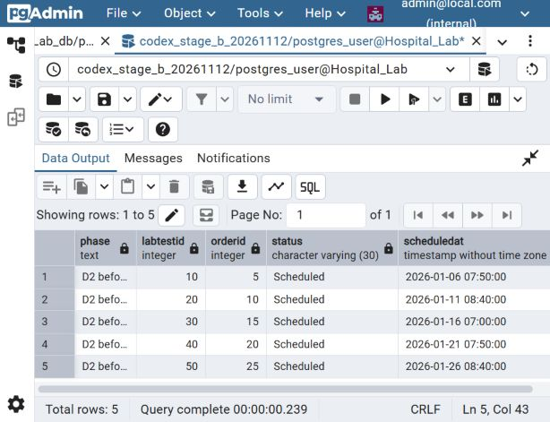 | 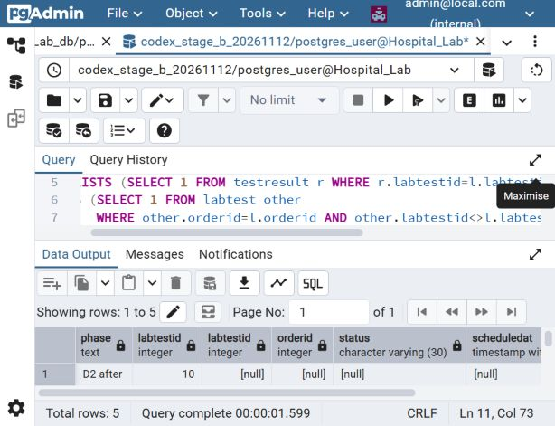 |  |

### D3 — מחיקת רופאי הדגמה שאין להם הזמנות

**תיאור:** נמחקים רופאים שמספר הרישיון שלהם מתחיל ב־DEMO-LIC-, שאין להם אף הזמנה, ורק אם ההתמחות שלהם ממשיכה להיות מיוצגת בידי רופא פעיל אחר. נמחקו 76 שורות. המסך: הזמנת בדיקות (רשימת רופאים).

```sql
DELETE FROM doctor d
WHERE d.licensenumber LIKE 'DEMO-LIC-%'
  AND NOT EXISTS (SELECT 1 FROM testorder o WHERE o.doctorid=d.doctorid)
  AND EXISTS (SELECT 1 FROM doctor active JOIN testorder o USING(doctorid)
              WHERE active.specialty=d.specialty AND active.doctorid<>d.doctorid)
RETURNING d.doctorid,d.firstname,d.lastname,d.specialty;
```

| לפני | הרצה | אחרי |
|---|---|---|
| 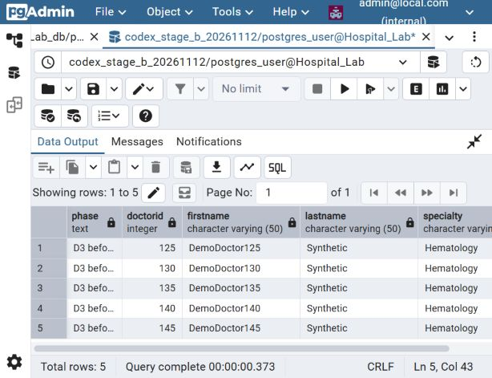 | 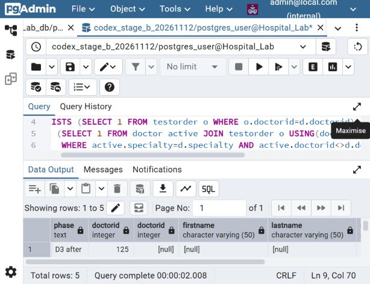 | 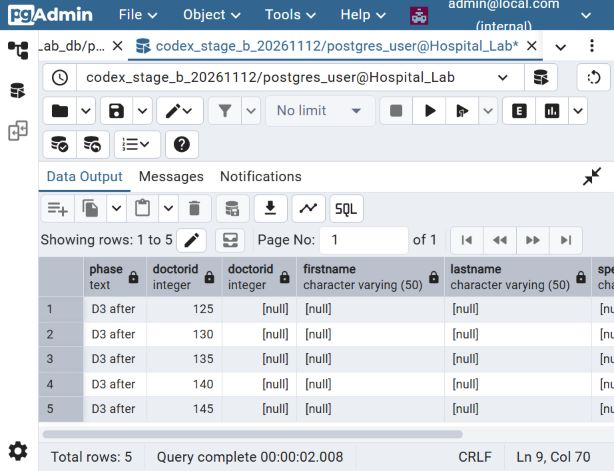 |

## 6. שאילתות UPDATE

השאילתות הורצו ותועדו באותה שיטה כמו המחיקות: לפני, הרצה ואחרי, ובסוף ROLLBACK. בצילומי ה"אחרי" רואים את אותן רשומות עם הערך החדש.

### U1 — הסלמת עדיפות הזמנות ל־STAT

**תיאור:** עדיפות ההזמנה משתנה ל־STAT בהזמנות שיש בהן תוצאה חריגה עם התראה פתוחה בחומרה High או Critical. השאילתה משתמשת ב־EXISTS על צירוף של שלוש טבלאות. עודכנו 582 שורות. המסך: הזמנת בדיקות.

```sql
UPDATE testorder o SET priority='STAT'
WHERE o.priority<>'STAT' AND EXISTS (
 SELECT 1 FROM labtest l JOIN testresult r USING(labtestid)
 JOIN labalert a USING(resultid)
 WHERE l.orderid=o.orderid AND r.isabnormal AND a.status='Open'
   AND a.severity IN ('High','Critical')
)
RETURNING o.orderid,o.patientid,o.doctorid,o.priority;
```

| לפני | הרצה | אחרי |
|---|---|---|
| 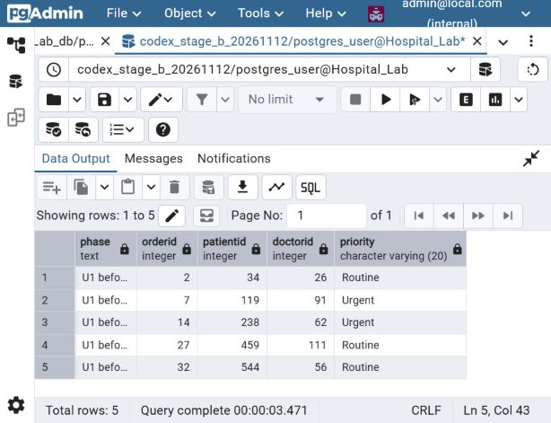 |  | 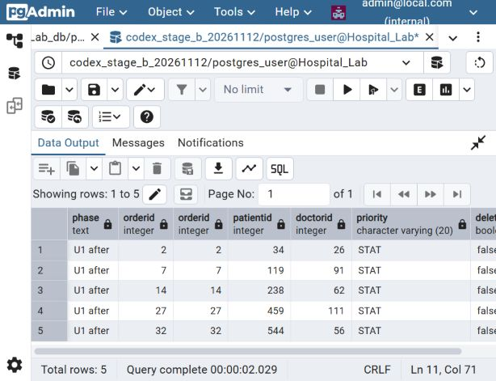 |

### U2 — סגירת התראות שאושרו

**תיאור:** התראות במצב Acknowledged שאושרו לפני 1.7.2026, בבדיקות שהושלמו, עוברות למצב Resolved. השאילתה מצרפת את LABALERT, ‏TESTRESULT, ‏LABTEST ו־TESTORDER. עודכנו 914 שורות. המסך: תוצאות והתראות.

```sql
UPDATE labalert a SET status='Resolved'
FROM testresult r JOIN labtest l USING(labtestid) JOIN testorder o USING(orderid)
WHERE a.resultid=r.resultid AND a.status='Acknowledged'
  AND a.acknowledgedat<TIMESTAMP '2026-07-01'
  AND l.status='Completed' AND o.orderedat<r.resultedat
RETURNING a.alertid,a.resultid,a.status,a.acknowledgedat;
```

| לפני | הרצה | אחרי |
|---|---|---|
|  | 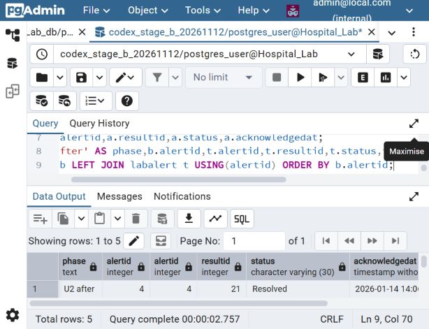 | 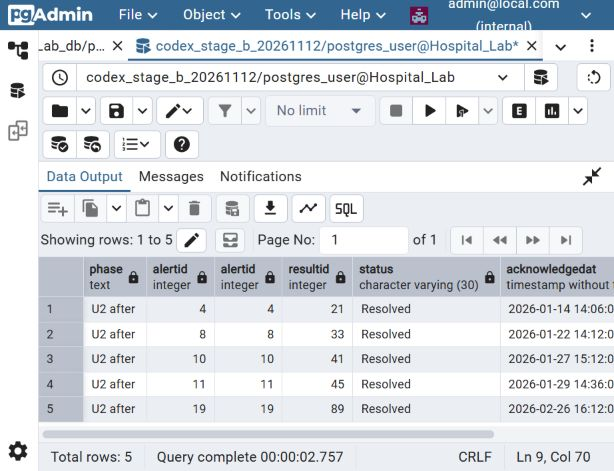 |

### U3 — שיוך טכנאי לבדיקות דחופות

**תיאור:** נבחר הטכנאי שההסמכה שלו בתוקף בתאריך 12.11.2026 ושיש לו הכי מעט בדיקות ממתינות. הוא משויך לכל הבדיקות המתוכננות שאין להן טכנאי, בהזמנות בעדיפות Urgent או STAT. השאילתה משתמשת ב־CTE, ב־GROUP BY ובשדה ה־DATE של תוקף ההסמכה. עודכנו 602 שורות. המסך: ניהול בדיקות מעבדה.

```sql
WITH candidate AS (
 SELECT t.technicianid FROM labtechnician t LEFT JOIN labtest l USING(technicianid)
 WHERE t.certificationexpireson>=DATE '2026-11-12'
 GROUP BY t.technicianid
 ORDER BY COUNT(l.labtestid) FILTER (WHERE l.status IN ('Scheduled','InProgress')),
          t.technicianid LIMIT 1
)
UPDATE labtest l SET technicianid=c.technicianid
FROM candidate c,testorder o
WHERE l.orderid=o.orderid AND l.status='Scheduled' AND l.technicianid IS NULL
  AND o.priority IN ('Urgent','STAT')
RETURNING l.labtestid,l.orderid,l.status,l.technicianid;
```

| לפני | הרצה | אחרי |
|---|---|---|
|  | 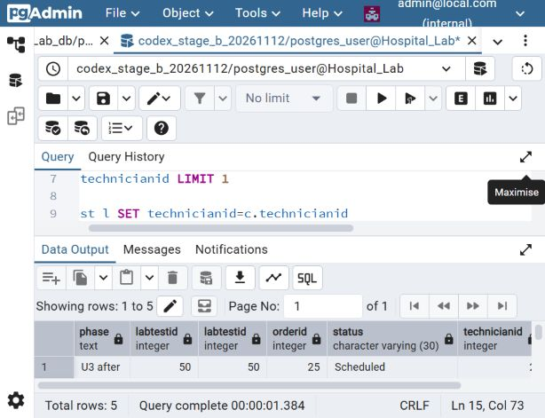 | 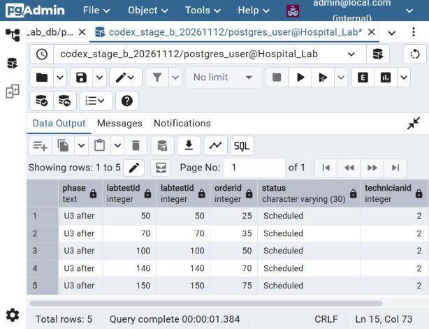 |

## 7. ROLLBACK ו־COMMIT

ההדגמה מתבצעת על הזמנה אחת, בעמודה Notes. טבלה זמנית שומרת את הערך המקורי, כדי שנוכל להוכיח את מצב הבסיס בכל שלב:

1. **ROLLBACK** — מוסיפים לשדה את הסימון [ROLLBACK DEMO] ומציגים אותו בתוך הטרנזקציה. אחרי ROLLBACK הערך חוזר למקורו, והעמודה restored מחזירה true.
2. **COMMIT** — מוסיפים לשדה את הסימון [COMMIT DEMO]. אחרי COMMIT השינוי נשמר, והעמודה persisted מחזירה true.

```sql
-- PostgreSQL / pgAdmin: הרצה על עותק ההדגמה בלבד.
-- נבחרת הזמנה קיימת; טבלה זמנית שומרת מצב קודם ומשמשת להוכחה מדויקת.
CREATE TEMP TABLE transaction_demo AS
SELECT orderid,notes AS old_notes FROM testorder ORDER BY orderid LIMIT 1;
SELECT 'before rollback' AS phase,o.orderid,o.notes FROM testorder o JOIN transaction_demo t USING(orderid);
BEGIN;
UPDATE testorder SET notes=COALESCE(notes,'')||' [ROLLBACK DEMO]'
WHERE orderid=(SELECT orderid FROM transaction_demo);
SELECT 'inside rollback' AS phase,o.orderid,o.notes FROM testorder o JOIN transaction_demo t USING(orderid);
ROLLBACK;
SELECT 'after rollback' AS phase,o.orderid,o.notes,
       o.notes IS NOT DISTINCT FROM t.old_notes AS restored
FROM testorder o JOIN transaction_demo t USING(orderid);

SELECT 'before commit' AS phase,o.orderid,o.notes FROM testorder o JOIN transaction_demo t USING(orderid);
BEGIN;
UPDATE testorder SET notes=COALESCE(notes,'')||' [COMMIT DEMO]'
WHERE orderid=(SELECT orderid FROM transaction_demo);
SELECT 'inside commit' AS phase,o.orderid,o.notes FROM testorder o JOIN transaction_demo t USING(orderid);
COMMIT;
SELECT 'after commit' AS phase,o.orderid,o.notes,
       o.notes IS NOT DISTINCT FROM COALESCE(t.old_notes,'')||' [COMMIT DEMO]' AS persisted
FROM testorder o JOIN transaction_demo t USING(orderid);
-- השינוי האחרון נשאר בכוונה לצורך הוכחת COMMIT.
DROP TABLE transaction_demo;
```

**הדגמת ROLLBACK:**

| לפני | בתוך הטרנזקציה | אחרי ROLLBACK |
|---|---|---|
| 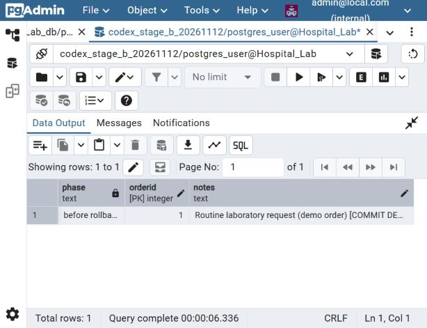 | 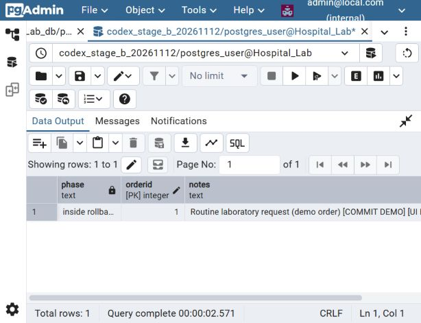 | 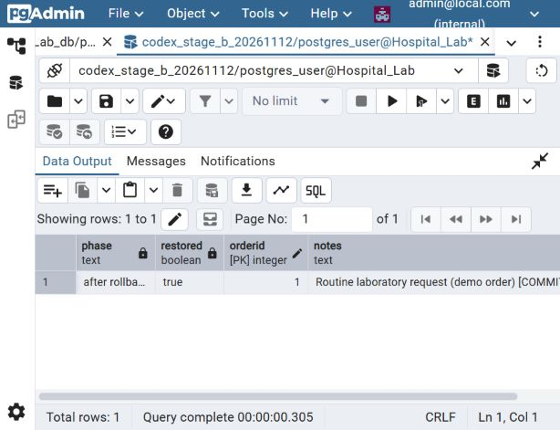 |

**הדגמת COMMIT:**

| לפני | בתוך הטרנזקציה | אחרי COMMIT |
|---|---|---|
| 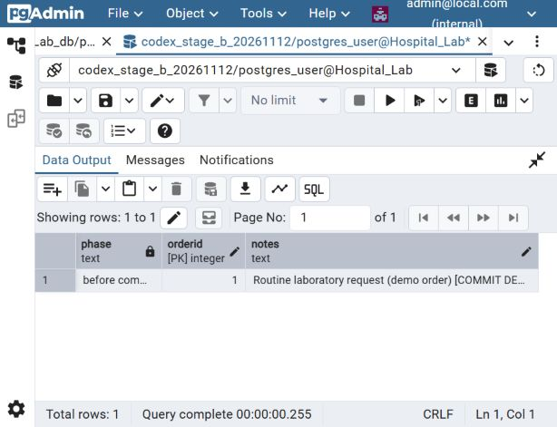 | 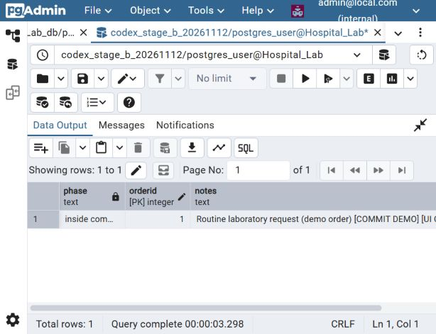 |  |

## 8. אילוצים

הוספנו שלושה אילוצי CHECK שלא היו בשלב א׳. אילוץ בבסיס הנתונים מגן על הנתונים מכל מקור, בין אם מהממשק, מסקריפט או מייבוא, ולא רק מבדיקות בצד האפליקציה. כל אילוץ נבדק בעת ההוספה גם מול הרשומות הקיימות, וכל הרשומות עמדו בו. לכל אילוץ ניסינו להכניס שורה שסותרת אותו, וקיבלנו שגיאה עם קוד 23514 (check_violation) ועם שם האילוץ.

הוספת האילוצים ב־ALTER TABLE, ורשימת האילוצים בקטלוג אחרי ההוספה:

| הרצת ALTER TABLE | האילוצים בקטלוג |
|---|---|
| 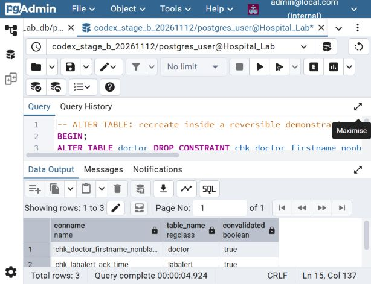 | 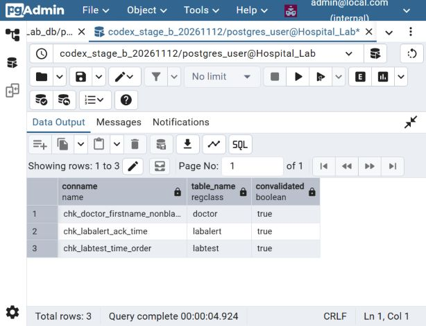 |
### 1. chk_doctor_firstname_nonblank — שם רופא לא ריק

**הטבלה:** DOCTOR. **המטרה והתועלת:** האילוץ NOT NULL מתיר שם שמכיל רווחים בלבד. רופא כזה יופיע ללא שם במסכים ובדוחות. האילוץ מחייב שאחרי הסרת הרווחים יישאר לפחות תו אחד.

**השינוי:**

```sql
ALTER TABLE doctor ADD CONSTRAINT chk_doctor_firstname_nonblank
 CHECK (length(btrim(firstname))>0);
```

**ניסיון הכנסה שסותר את האילוץ:**

```sql
INSERT INTO doctor(doctorid,licensenumber,firstname,lastname,specialty)
VALUES(-900001,'DEMO-BAD-NAME','   ','Demo','Demo');
```

**התוצאה:** שגיאת הרצה, `violates check constraint "chk_doctor_firstname_nonblank"` (SQL state 23514).

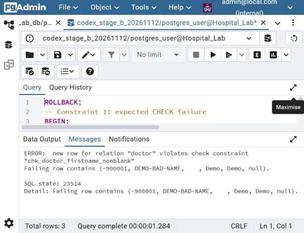

### 2. chk_labtest_time_order — סדר מועדי הבדיקה

**הטבלה:** LABTEST. **המטרה והתועלת:** מועדי הבדיקה חייבים להיות בסדר הגיוני: ההתחלה לא לפני התכנון, וסיום מחייב התחלה ולא יכול להקדים אותה. בלי האילוץ, חישובי משך הבדיקה יכולים להחזיר זמנים שליליים. ערכי NULL מותרים, כי בדיקה שעוד לא התחילה או לא הסתיימה עדיין אין לה מועדים.

**השינוי:**

```sql
ALTER TABLE labtest ADD CONSTRAINT chk_labtest_time_order
 CHECK ((startedat IS NULL OR scheduledat IS NULL OR startedat>=scheduledat)
    AND (completedat IS NULL OR (startedat IS NOT NULL AND completedat>=startedat)));
```

**ניסיון הכנסה שסותר את האילוץ:**

```sql
INSERT INTO labtest(labtestid,status,scheduledat,startedat,completedat,orderid,testtypeid)
SELECT -900001,'Completed',TIMESTAMP '2026-01-02',TIMESTAMP '2026-01-01',
       TIMESTAMP '2026-01-03',o.orderid,tt.testtypeid
FROM testorder o CROSS JOIN testtype tt ORDER BY o.orderid,tt.testtypeid LIMIT 1;
```

**התוצאה:** שגיאת הרצה, `violates check constraint "chk_labtest_time_order"` (SQL state 23514).


### 3. chk_labalert_ack_time — אישור התראה אחרי יצירתה

**הטבלה:** LABALERT. **המטרה והתועלת:** אי אפשר לאשר התראה לפני שנוצרה. האילוץ שומר על נכונות דוחות זמני התגובה להתראות. NULL מותר להתראה שעוד לא אושרה.

**השינוי:**

```sql
ALTER TABLE labalert ADD CONSTRAINT chk_labalert_ack_time
 CHECK (acknowledgedat IS NULL OR acknowledgedat>=createdat);
```

**ניסיון הכנסה שסותר את האילוץ:**

```sql
INSERT INTO labalert(alertid,severity,message,createdat,status,acknowledgedat,resultid)
SELECT -900001,'Low','Invalid demonstration',TIMESTAMP '2026-02-02',
       'Acknowledged',TIMESTAMP '2026-02-01',resultid
FROM testresult ORDER BY resultid LIMIT 1;
```

**התוצאה:** שגיאת הרצה, `violates check constraint "chk_labalert_ack_time"` (SQL state 23514).

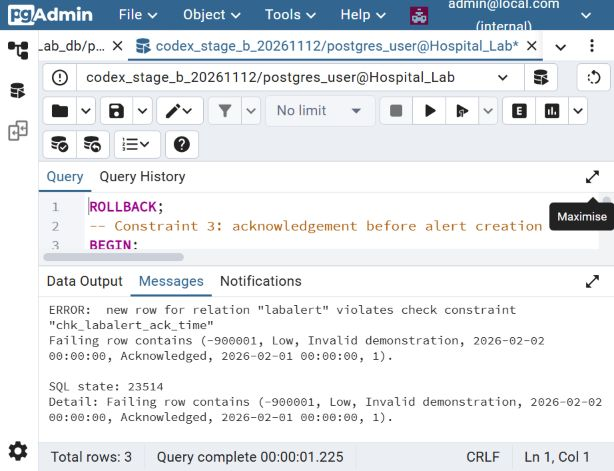

## 9. אינדקסים

אינדקסים כבר קיימים אוטומטית על המפתחות הראשיים ועל עמודות UNIQUE. לכן בחרנו שלושה אינדקסים חדשים לדפוסי חיפוש שחוזרים במסכי המערכת. מנגד, כל אינדקס תופס מקום ומאט מעט INSERT, ‏UPDATE ו־DELETE. במעבדה רוב העבודה במסכים היא קריאה, ולכן המחיר הזה כדאי.

בכל אינדקס הרצנו את אותה שאילתה ב־EXPLAIN (ANALYZE, BUFFERS) לפני יצירת האינדקס ואחריה, ועדכנו סטטיסטיקות ב־ANALYZE. לא כפינו שימוש באינדקס: המתכנן בחר בו בעצמו.

### 1. idx_testorder_patient_date

**השימוש:** היסטוריית ההזמנות של מטופל לפי טווח תאריכים (מסך ניהול מטופלים). **המוטיבציה:** אינדקס מורכב: קודם שוויון על PatientID, ואחר כך טווח ומיון לפי OrderedAt. כך מגיעים ישר להזמנות של המטופל, והן כבר ממוינות לפי תאריך.

```sql
CREATE INDEX idx_testorder_patient_date ON testorder(patientid,orderedat);
```

**השאילתה שנמדדה:**

```sql
SELECT o.orderid,o.orderedat,p.firstname,p.lastname,d.firstname AS doctor_firstname
FROM testorder o JOIN patient p USING(patientid) JOIN doctor d USING(doctorid)
WHERE o.patientid=17 AND o.orderedat>=TIMESTAMP '2026-01-01'
ORDER BY o.orderedat;
```

**לפני יצירת האינדקס:**

| תוכנית ביצוע | זמן ריצה |
|---|---|
|  |  |

**אחרי יצירת האינדקס:**

| תוכנית ביצוע | זמן ריצה |
|---|---|
|  | 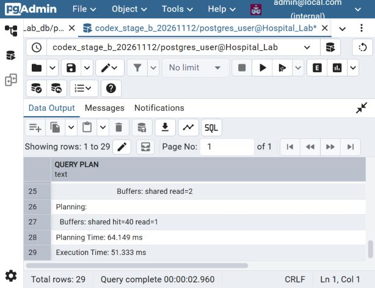 |

**התוצאה:** Seq Scan על TESTORDER הוחלף ב־Bitmap Index Scan על האינדקס. בצילומים: 13.405 ms לפני, ו־51.333 ms אחרי. חציון של חמש הרצות: 0.637 ms לפני, ו־0.189 ms אחרי.

### 2. idx_labtest_type_status

**השימוש:** סינון בדיקות לפי סוג ומצב (מסך ניהול בדיקות מעבדה). **המוטיבציה:** צירוף סוג הבדיקה והמצב סלקטיבי בהרבה מכל אחד מהם לבד. מתוך 30,000 בדיקות נשלפות כ־40 בלבד.

```sql
CREATE INDEX idx_labtest_type_status ON labtest(testtypeid,status);
```

**השאילתה שנמדדה:**

```sql
SELECT l.labtestid,tt.testname,l.status,o.orderid,o.orderedat
FROM labtest l JOIN testtype tt USING(testtypeid) JOIN testorder o USING(orderid)
WHERE l.testtypeid=25 AND l.status='Completed' ORDER BY l.labtestid;
```

**לפני יצירת האינדקס:**

| תוכנית ביצוע | זמן ריצה |
|---|---|
| 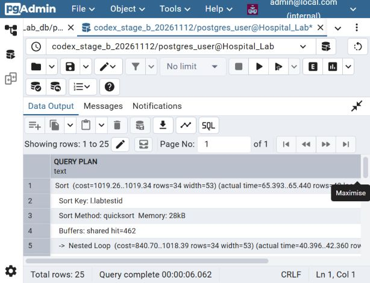 |  |

**אחרי יצירת האינדקס:**

| תוכנית ביצוע | זמן ריצה |
|---|---|
| 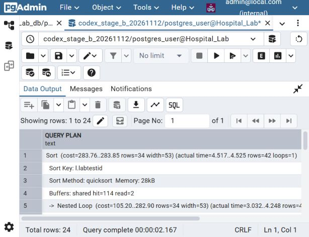 |  |

**התוצאה:** Seq Scan על LABTEST הוחלף ב־Index Scan על האינדקס. בצילומים: 82.255 ms לפני, ו־6.719 ms אחרי. חציון של חמש הרצות: 3.051 ms לפני, ו־0.983 ms אחרי.

### 3. idx_labalert_open_created

**השימוש:** תור ההתראות הפתוחות לפי תאריך (מסך תוצאות והתראות). **המוטיבציה:** אינדקס חלקי (WHERE status='Open'): הוא מכיל רק התראות פתוחות, ולכן קטן ומהיר יותר מאינדקס על כל ההתראות.

```sql
CREATE INDEX idx_labalert_open_created ON labalert(createdat) WHERE status='Open';
```

**השאילתה שנמדדה:**

```sql
SELECT a.alertid,a.severity,a.createdat,r.isabnormal,l.labtestid
FROM labalert a JOIN testresult r USING(resultid) JOIN labtest l USING(labtestid)
WHERE a.status='Open' AND a.createdat>=TIMESTAMP '2026-06-01'
 AND a.createdat<TIMESTAMP '2026-06-08' ORDER BY a.createdat;
```

**לפני יצירת האינדקס:**

| תוכנית ביצוע | זמן ריצה |
|---|---|
|  | 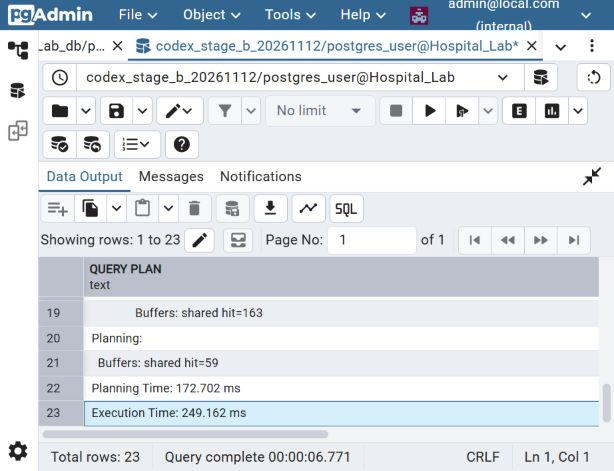 |

**אחרי יצירת האינדקס:**

| תוכנית ביצוע | זמן ריצה |
|---|---|
| 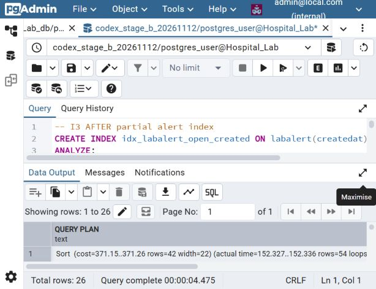 | 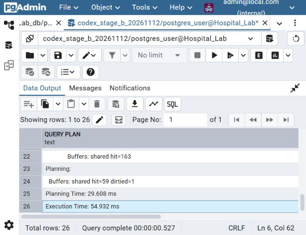 |

**התוצאה:** Seq Scan על LABALERT הוחלף ב־Bitmap Index Scan על האינדקס החלקי. בצילומים: 249.162 ms לפני, ו־54.932 ms אחרי. חציון של חמש הרצות: 0.841 ms לפני, ו־0.522 ms אחרי.

### סיכום והסבר התוצאות

| אינדקס | צילום לפני (ms) | צילום אחרי (ms) | חציון 5 הרצות לפני (ms) | חציון 5 הרצות אחרי (ms) | שיפור לפי החציון |
|---|---:|---:|---:|---:|---|
| idx_testorder_patient_date | 13.405 | 51.333 | 0.637 | 0.189 | פי 3.4 |
| idx_labtest_type_status | 82.255 | 6.719 | 3.051 | 0.983 | פי 3.1 |
| idx_labalert_open_created | 249.162 | 54.932 | 0.841 | 0.522 | פי 1.6 |

- **בכל שלושת האינדקסים המתכנן החליף סריקה מלאה של הטבלה (Seq Scan) בגישה דרך האינדקס.** לכן הוא קורא רק את השורות הרלוונטיות ולא את כל הטבלה.
- **השיפור הגדול ביותר נמדד באינדקס על LABTEST**, הטבלה הגדולה (30,000 שורות), שממנה נשלפות כ־40 שורות בלבד. ככל שהטבלה גדולה והסינון סלקטיבי יותר, התועלת גדולה יותר.
- **באינדקס הראשון הצילום מראה דווקא זמן גבוה יותר אחרי יצירת האינדקס.** בהרצה הראשונה אחרי היצירה, דפי האינדקס החדש נקראו מהדיסק ולא מהזיכרון (shared read בתוכנית). זמן הצילום כולל את הקריאה הזו. העלות המוערכת של התוכנית ירדה מ־160.74 ל־28.06, ובחמש הרצות חוזרות החציון ירד מ־0.637 ms ל־0.189 ms. לכן ההשוואה האמינה היא לפי החציון.
- **בצילומים הזמנים גבוהים מהחציון** בגלל עומס על המחשב ומטמון קר בזמן הצילום. ההשוואה בין לפני לאחרי נעשתה באותם תנאים. [המדידות המלאות](audit/10_repeated_index_plans.txt).

## 10. גיבוי backup2 ושחזור

הקובץ [backup2.dump](backup2.dump) הוא גיבוי מעודכן בפורמט Custom, שנוצר ב־pg_dump. הוא כולל את כל הנתונים, את העמודה החדשה, את שלושת האילוצים, את שלושת האינדקסים ואת השינוי שנשמר בהדגמת COMMIT. טביעת SHA-256 של הקובץ:

```text
6fcacd9ef01f0bad38d48ff35348453af207af81723bd78855ac054150ff6a98
```

**שחזור באותו מחשב:** הגיבוי שוחזר לבסיס נתונים נפרד, וכל הרשומות, העמודות, האילוצים והאינדקסים הושוו לבסיס המקורי ונמצאו זהים ([השוואת השחזור](audit/13_restore_comparison.txt)).

**שחזור במחשב אחר:** ב־15.11.2026 הגיבוי שוחזר במחשב של מוריה, שאינו המחשב שבו נוצר הגיבוי, לפי ההוראות ב־[PullAndRestore.md](PullAndRestore.md):

1. נוצר בסיס נתונים חדש וריק בשם `stage_b_partner_restore_20261114`.
2. ב־pgAdmin נבחר Restore: פורמט Custom, הקובץ backup2.dump, וסומנו Do not save Owner ו־Privileges. השחזור הסתיים בהודעה Successfully completed.
3. ב־Query Tool הורצה בדיקת [PartnerValidation.sql](PartnerValidation.sql). ספירות כל שמונה הטבלאות תאמו (patient‏ 3,000; ‏doctor, ‏testtype ו־labtechnician‏ 500 כל אחת; ‏testorder‏ 5,000; ‏labtest‏ 30,000; ‏testresult‏ 24,000; ‏labalert‏ 3,157), והתקבלה ההודעה PASS.

| סיום השחזור | ספירות הטבלאות | בדיקת PartnerValidation |
|---|---|---|
| 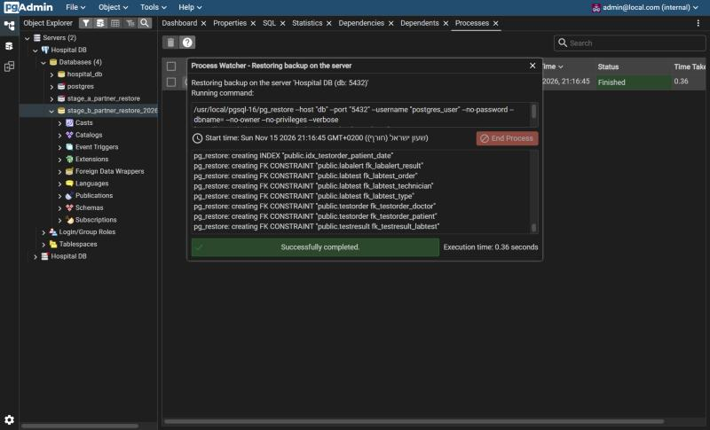 |  | 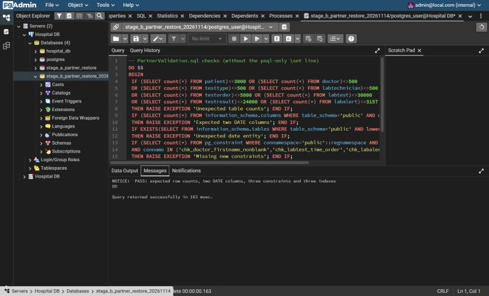 |

## 11. סדר הרצת הקבצים

**בבסיס נתונים חדש וריק:**

1. `createTables.sql` ו־`insertTables.sql` מתיקיית שלב א׳. הקבצים כבר כוללים את העמודה החדשה, ולכן אין צורך להריץ את StageA_Migration.sql.
2. החלק הראשון של `Constraints.sql`: הטרנזקציה עם שלוש פקודות ALTER TABLE.
3. `Queries.sql`. כל שאילתת שינוי מסתיימת ב־ROLLBACK, ולכן הנתונים לא משתנים.
4. `RollbackCommit.sql` ואחריו `Index.sql`.
5. שלוש ההכנסות שבסוף `Constraints.sql`, כל אחת בנפרד. הן אמורות להיכשל, וזו המטרה. אחרי כל שגיאה מריצים ROLLBACK.

**בבסיס נתונים קיים משלב א׳:** מריצים קודם פעם אחת את `StageA_Migration.sql`, ואחר כך ממשיכים מהשלב השני.

**מגיבוי:** משחזרים את `backup2.dump` לבסיס חדש, כמו בסעיף 10. בגיבוי כבר יש את האילוצים ואת האינדקסים.
