# דוח הפרויקט — שלב ב׳: מערכת מעבדת בית חולים

מגישות: נועה מנוסה ומוריה כדורי (לפי דוח שלב א׳).

**בדיקת הגשה: 14.11.2026.** [מפת דרישות וראיות](SubmissionAudit.md) · [נספח כל 85 צילומי pgAdmin](screenshots/README.md) · [משיכה ושחזור אצל השותפה](PullAndRestore.md). תג ההגשה: `stage-b-2026-11-14`.

## סדר עבודה ותיקון שלב א׳

הקבצים מיועדים ל-PostgreSQL. שמונת הישויות והמפתחות נשמרו. אין טבלת DAT או Date. קיימת patient.dateofbirth מסוג DATE ונוספה labtechnician.certificationexpireson מסוג DATE NOT NULL, המייצגת תוקף ההסמכה ולא נגזרת משדה אחר. מועדי הזמנות, ביצוע ותוצאות נשארו TIMESTAMP משום ששעת האירוע משמעותית.

בבסיס ריק מריצים את createTables.sql ואת insertTables.sql המעודכנים משלב א׳ באמצעות psql מתוך תיקיית שלב א׳. בבסיס קיים מריצים פעם אחת את StageA_Migration.sql בלבד, לאחר גיבוי. תאריכי התוקף הסינתטיים זהים במיגרציה ובאכלוס. שלוש שיטות האכלוס ומספר הרשומות נשמרו; המחולל בפייתון יוצר בדיקות/תוצאות/התראות בלבד ואינו דורש שינוי.

לאחר מכן מריצים את הוספת האילוצים (החלק הראשון של Constraints.sql), כל SELECT בנפרד, הדגמות השינוי בנפרד, RollbackCommit.sql ואז Index.sql. ההכנסות השגויות דורשות טיפול בטרנזקציה אחרי השגיאה, כמוסבר בקובץ. אין להריץ את כל Constraints.sql עם ON_ERROR_STOP=on משום שהכישלונות מכוונים.

השינויים ב-Queries.sql מתבטלים ב-ROLLBACK כדי לא להפחית את כמויות האכלוס. RollbackCommit.sql משאיר שינוי מסומן בשדה Notes במכוון. השאילתות הן הדגמות ניהוליות על נתוני דמה; כללי ההסלמה והארכוב אינם מדיניות רפואית.

## 3NF, מילון נתונים ותרשימים

המפתחות הראשיים קובעים את מאפייני הישויות. מספר זיהוי מטופל, מספר רישיון רופא, קוד בדיקה ומספר הסמכה הם מפתחות חלופיים ייחודיים. פרטי מטופל ורופא אינם משוכפלים בהזמנה; פרטי סוג בדיקה נשמרים בקטלוג; הזמנה מקשרת מטופל ורופא, בדיקה מקשרת הזמנה/סוג/טכנאי, תוצאה שייכת לבדיקה אחת, והתראה לתוצאה. אין מפתח מורכב היוצר תלות חלקית. אין תלות טרנזיטיבית מוכרת בין מאפיינים שאינם מפתח במסגרת ההנחות האלה. certificationexpireson תלוי בטכנאי/הסמכתו היחידה; אם תידרש היסטוריית הסמכות מרובות, יהיה צורך בישות נפרדת. יחידת תוצאה היא יחידת המדידה בפועל, ועשויה להיות שונה מברירת המחדל בקטלוג, לכן אינה העתק נגזר שלו. isabnormal הוא סימון נתון דמה לפי הקשר הבדיקה, ואינו נגזר מ-numericvalue לבדו.

תוספת למילון: `labtechnician.certificationexpireson | DATE | NOT NULL | תאריך אחרון לתוקף ההסמכה | ללא DEFAULT`.

התרשימים המעודכנים יובאו לחשבון ERDPlus באישור המשתמשת, כגרסאות נפרדות. [פתיחת ERD מעודכן](https://erdplus.com/diagrams/732415), [פתיחת DSD סופי](https://erdplus.com/diagrams/732507). ה-ERD מכיל שמונה ישויות ושבעה קשרים ואת המאפיין החדש CertificationExpiresOn. ב-DSD נבדקו תאריך חובה והפורמט של אורכי VARCHAR; טיפוסי כל 53 העמודות במקור הסופי הושוו ל-createTables.sql. קובצי המקור הישנים נשמרו.

הקובץ הסופי לייבוא הוא [DSD-stage-b-verified.erdplus](diagrams/DSD-stage-b-verified.erdplus). ERDPlus שומר VARCHAR(n) עם size נפרד, NUMERIC(p s) עם size כגון 12,3, וטיפוסים כמו TIMESTAMP/TEXT/BOOLEAN כ-Custom עם שם הטיפוס ב-size. הפורמט אומת באמצעות שינוי בממשק וייצוא קובצי דוגמה מהאתר. גרסת DSD-revised הראשונית בחשבון היא גרסת ביניים; השתמשו ב-DSD-stage-b-verified.

פקודת Download image נכשלה דרך כלי השליטה וגם בלחיצה ידנית של המשתמשת. לכן נוצרו תמונות מלאות מקומית מקובצי המקור שאומתו באתר; הן מוצגות בסעיף התרשימים המלאים להלן, עם ציון אופן הפקתן. הצילומים הבאים נשמרו כראיות לבדיקה באתר בלבד.


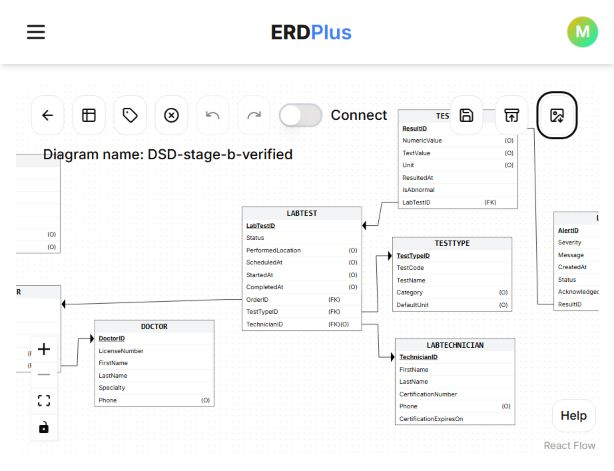

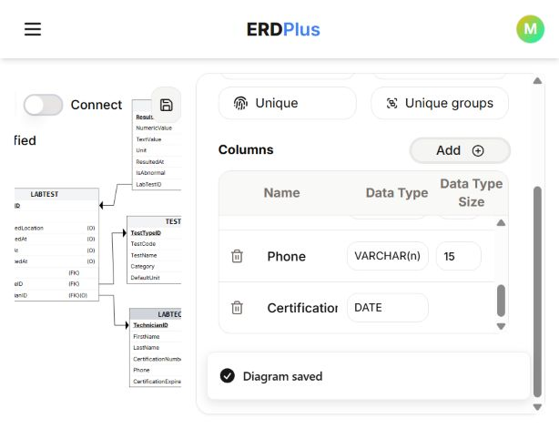

ראו את שני התרשימים המלאים בסעיף הבא.

## התרשימים המלאים המעודכנים

קובצי המקור יובאו ונבדקו ב-ERDPlus. לאחר שגם המשתמשת דיווחה שהורדה ידנית באמצעות Download image נכשלת, נוצרו התמונות הבאות מקובצי המקור המאומתים באמצעות מחולל מקומי. **אלה תמונות מלאות של המודל המעודכן, ולא צילומי מסך או הורדות PNG מקוריות מהאתר.** פריסת הרכיבים הורחבה לשיפור הקריאות; הישויות, השדות, המפתחות והקשרים נשמרו. התמונות הישנות של שלב א׳ נשמרו ללא שינוי ואינן מייצגות את העמודה החדשה.

### ERD מעודכן

התרשים כולל שמונה ישויות, 46 מאפיינים ושבעה קשרים. שני מאפייני DATE משמעותיים מודגשים בירוק. קו תוקף ההסמכה מחובר ישירות לטכנאי, ומיקומו שונה בתצוגה המקומית כדי שלא יחצה את מאפיין המפתח. ריבוי הקשרים נשמר מהמקור שנבדק באתר.

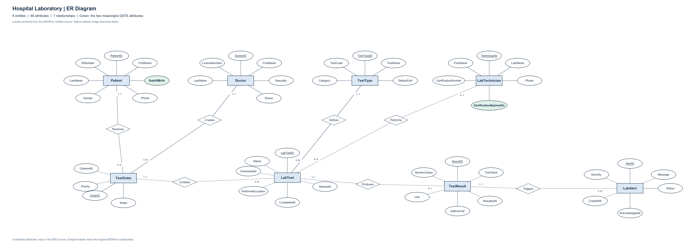

[PNG ברזולוציה מלאה](diagrams/updated-erd.png) · [JPEG](diagrams/updated-erd.jpeg) · [SVG וקטורי](diagrams/updated-erd.svg) · [מקור ERDPlus](diagrams/ERD-revised.erdplus)

### DSD מעודכן

התרשים מציג את כל שמונה הטבלאות, 53 העמודות ושבעת המפתחות הזרים, לרבות טיפוסים, אורכי מחרוזות, אפשרות NULL, מפתחות ראשיים וייחודיות. TechnicianID בבדיקה הוא אופציונלי, ולכן מסומן 0..1 בצד הטכנאי; LabTestID בתוצאה ייחודי, ולכן נשמר הקשר 1 מול 0..1 בין בדיקה לתוצאה. UQ נבדק מול createTables.sql. התמונות נבדקו חזותית לאחר יצירתן.

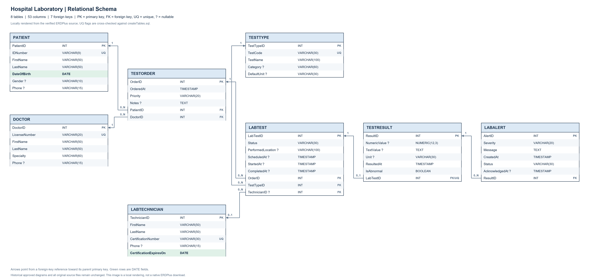

[PNG ברזולוציה מלאה](diagrams/updated-dsd.png) · [SVG וקטורי](diagrams/updated-dsd.svg) · [מקור ERDPlus סופי](diagrams/DSD-stage-b-verified.erdplus)

יצירה חוזרת: `python audit/render_verified_diagrams.py`. רישום תכולה, ספירות ו-SHA-256 נמצא ב-[local_diagram_rendering.json](audit/local_diagram_rendering.json). אין צורך להמשיך לנסות את כפתור ההורדה לצורך צפייה בתמונות האלה. אם תידרש דווקא הורדה מקורית מהאתר, התקלה בכפתור נותרה פתוחה ויש לבדוק אותה בדפדפן אחר או מול האתר.


## SELECT — 8 צרכים עסקיים, 12 מימושים

מיפוי GUI מוצע לצורך השלב הסופי: דשבורד מנהל — Q1/Q4/Q5/Q8; תיק מטופל — Q2/Q3; צוות והסמכות — Q6; תור הזמנות — Q7. זהו מיפוי מוצע ולא הוכחה שקיימים מסכי אב־טיפוס.

כל שאילתה מחזירה יותר משתי עמודות וכוללת מזהים ושמות/מידע תפעולי. Q5 מפרקת יום, חודש ושנה; Q1 ו-Q6 משתמשות גם בחלקי תאריך. אין LIMIT בקוד העסקי; בצילום מציגים עד חמש שורות בלבד.

### Q1A

עומס חודשי לרופא — צבירה אחת לאחר צירוף.

```sql
SELECT d.doctorid, d.firstname, d.lastname,
       EXTRACT(YEAR FROM o.orderedat)::int AS order_year,
       EXTRACT(MONTH FROM o.orderedat)::int AS order_month,
       COUNT(*) AS test_count,
       COUNT(*) FILTER (WHERE l.status='Completed') AS completed_count
FROM doctor d JOIN testorder o USING(doctorid) JOIN labtest l USING(orderid)
GROUP BY d.doctorid, EXTRACT(YEAR FROM o.orderedat), EXTRACT(MONTH FROM o.orderedat)
ORDER BY order_year, order_month, d.doctorid;
```


### Q1B

אותו פלט באמצעות תתי־שאילתות מתואמות לכל רופא וחודש.

```sql
WITH months AS (
 SELECT DISTINCT d.doctorid, d.firstname, d.lastname,
        EXTRACT(YEAR FROM o.orderedat)::int AS order_year,
        EXTRACT(MONTH FROM o.orderedat)::int AS order_month
 FROM doctor d JOIN testorder o USING(doctorid) JOIN labtest l USING(orderid)
)
SELECT m.*,
 (SELECT COUNT(*) FROM testorder o JOIN labtest l USING(orderid)
  WHERE o.doctorid=m.doctorid AND EXTRACT(YEAR FROM o.orderedat)=m.order_year
    AND EXTRACT(MONTH FROM o.orderedat)=m.order_month) AS test_count,
 (SELECT COUNT(*) FROM testorder o JOIN labtest l USING(orderid)
  WHERE o.doctorid=m.doctorid AND EXTRACT(YEAR FROM o.orderedat)=m.order_year
    AND EXTRACT(MONTH FROM o.orderedat)=m.order_month
    AND l.status='Completed') AS completed_count
FROM months m ORDER BY order_year, order_month, doctorid;
```

A צפויה להיות יעילה יותר: צבירה לאחר מעבר משותף לעומת שתי ספירות חוזרות לכל רופא וחודש ב-B. יש למדוד; אינדקסים ותוכנית המתכנן יכולים לשנות זאת.

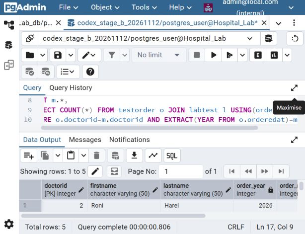


### Q2A

התראות פתוחות למטופל — צבירה ו-HAVING.

```sql
SELECT p.patientid, p.firstname, p.lastname, COUNT(*) AS open_alerts,
       COUNT(*) FILTER (WHERE a.severity IN ('High','Critical')) AS high_alerts
FROM patient p JOIN testorder o USING(patientid) JOIN labtest l USING(orderid)
JOIN testresult r USING(labtestid) JOIN labalert a USING(resultid)
WHERE a.status='Open'
GROUP BY p.patientid HAVING COUNT(*)>=2
ORDER BY open_alerts DESC, p.patientid;
```


### Q2B

אותו פלט באמצעות חישוב מתואם לכל מטופל וסינון חיצוני.

```sql
WITH totals AS (
 SELECT p.patientid, p.firstname, p.lastname,
 (SELECT COUNT(*) FROM testorder o JOIN labtest l USING(orderid)
  JOIN testresult r USING(labtestid) JOIN labalert a USING(resultid)
  WHERE o.patientid=p.patientid AND a.status='Open') AS open_alerts,
 (SELECT COUNT(*) FROM testorder o JOIN labtest l USING(orderid)
  JOIN testresult r USING(labtestid) JOIN labalert a USING(resultid)
  WHERE o.patientid=p.patientid AND a.status='Open'
    AND a.severity IN ('High','Critical')) AS high_alerts
 FROM patient p
)
SELECT * FROM totals WHERE open_alerts>=2 ORDER BY open_alerts DESC, patientid;
```

A צפויה להיות יעילה יותר באכלוס הנוכחי: מסננים התראות ומקבצים פעם אחת. B עשויה לבצע שתי ספירות לכל מטופל, כולל מטופלים ללא התראות. יש לאמת ב-EXPLAIN ANALYZE.


### Q3A

התוצאה האחרונה לכל מטופל — פונקציית חלון ושובר שוויון ResultID.

```sql
WITH ranked AS (
 SELECT p.patientid, p.firstname, p.lastname, tt.testname,
        r.resultid, r.resultedat, r.numericvalue, r.textvalue, r.isabnormal,
        ROW_NUMBER() OVER (PARTITION BY p.patientid
                          ORDER BY r.resultedat DESC, r.resultid DESC) AS rn
 FROM patient p JOIN testorder o USING(patientid) JOIN labtest l USING(orderid)
 JOIN testtype tt USING(testtypeid) JOIN testresult r USING(labtestid)
)
SELECT patientid, firstname, lastname, testname, resultid, resultedat,
       numericvalue, textvalue, isabnormal
FROM ranked WHERE rn=1 ORDER BY patientid;
```

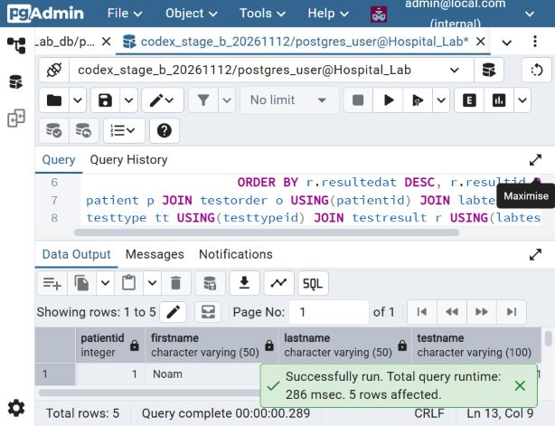


### Q3B

אותו פלט באמצעות NOT EXISTS של תוצאה מאוחרת יותר, כולל שובר שוויון.

```sql
SELECT p.patientid, p.firstname, p.lastname, tt.testname,
       r.resultid, r.resultedat, r.numericvalue, r.textvalue, r.isabnormal
FROM patient p JOIN testorder o USING(patientid) JOIN labtest l USING(orderid)
JOIN testtype tt USING(testtypeid) JOIN testresult r USING(labtestid)
WHERE NOT EXISTS (
 SELECT 1 FROM testorder o2 JOIN labtest l2 USING(orderid)
 JOIN testresult r2 USING(labtestid)
 WHERE o2.patientid=p.patientid
   AND (r2.resultedat,r2.resultid)>(r.resultedat,r.resultid)
)
ORDER BY p.patientid;
```

A ממיינת את קבוצות המטופלים פעם אחת. B בודקת היעדר תוצאה מאוחרת לכל מועמד; המתכנן עשוי להפוך זאת ל-Anti Join. A אינה תמיד מהירה יותר: יש להשוות בפועל ולשמור על שובר השוויון.


### Q4A

סוגי בדיקות שעומסם מעל ממוצע הקטלוג — CTE ותת־שאילתה.

```sql
WITH counts AS (
 SELECT tt.testtypeid, tt.testname, tt.category, COUNT(l.labtestid) AS test_count,
        COUNT(DISTINCT o.patientid) AS patient_count
 FROM testtype tt LEFT JOIN labtest l USING(testtypeid)
 LEFT JOIN testorder o USING(orderid)
 GROUP BY tt.testtypeid
)
SELECT * FROM counts WHERE test_count>(SELECT AVG(test_count) FROM counts)
ORDER BY test_count DESC, testtypeid;
```


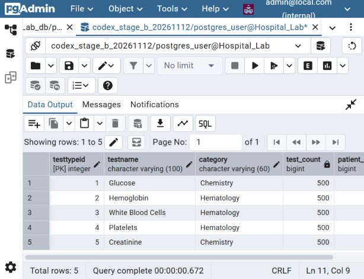

### Q4B

אותו פלט באמצעות AVG בחלון; הממוצע כולל גם סוגים ללא בדיקות.

```sql
WITH counts AS (
 SELECT tt.testtypeid, tt.testname, tt.category, COUNT(l.labtestid) AS test_count,
        COUNT(DISTINCT o.patientid) AS patient_count,
        AVG(COUNT(l.labtestid)) OVER () AS mean_count
 FROM testtype tt LEFT JOIN labtest l USING(testtypeid)
 LEFT JOIN testorder o USING(orderid)
 GROUP BY tt.testtypeid
)
SELECT testtypeid,testname,category,test_count,patient_count FROM counts
WHERE test_count>mean_count ORDER BY test_count DESC,testtypeid;
```

שתי הדרכים צוברות פעם אחת. A עשויה לממש CTE ולסרוק אותו שוב לחישוב ממוצע; B מוסיפה WindowAgg ללא סריקה חוזרת מפורשת. B צפויה לחסוך מעט עבודה, אך בקטלוג קטן ההפרש עשוי להיות זניח או הפוך.

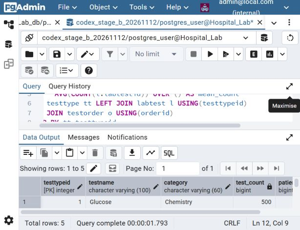


### Q5

פילוח הזמנות לפי יום, חודש, שנה ועדיפות, כולל מטופלים ורופאים ייחודיים.

```sql
SELECT EXTRACT(YEAR FROM o.orderedat)::int AS order_year,
       EXTRACT(MONTH FROM o.orderedat)::int AS order_month,
       EXTRACT(DAY FROM o.orderedat)::int AS order_day, o.priority,
       COUNT(DISTINCT o.orderid) AS order_count,
       COUNT(DISTINCT p.patientid) AS patient_count,
       COUNT(DISTINCT d.doctorid) AS doctor_count
FROM testorder o JOIN patient p USING(patientid) JOIN doctor d USING(doctorid)
GROUP BY 1,2,3,o.priority ORDER BY 1,2,3,o.priority;
```


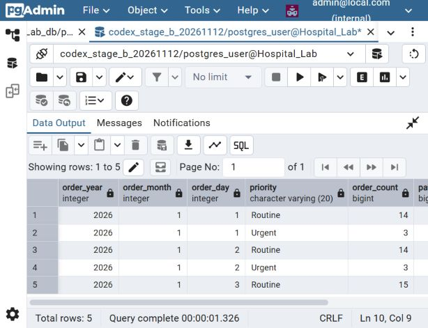

### Q6

תוקף הסמכת טכנאים ועומס — תאריך ייחוס קבוע שניתן להחליף במסך.

```sql
SELECT t.technicianid,t.firstname,t.lastname,t.certificationexpireson,
       EXTRACT(YEAR FROM t.certificationexpireson)::int AS expiry_year,
       EXTRACT(MONTH FROM t.certificationexpireson)::int AS expiry_month,
       t.certificationexpireson-DATE '2026-11-12' AS days_until_expiry,
       COUNT(l.labtestid) AS assigned_tests,
       COUNT(DISTINCT o.patientid) AS patients
FROM labtechnician t LEFT JOIN labtest l USING(technicianid)
LEFT JOIN testorder o USING(orderid)
WHERE t.certificationexpireson<=DATE '2026-11-12'+450
GROUP BY t.technicianid ORDER BY t.certificationexpireson,t.technicianid;
```

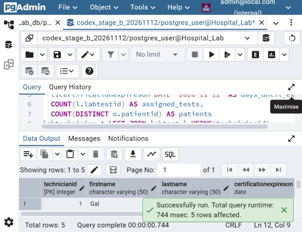

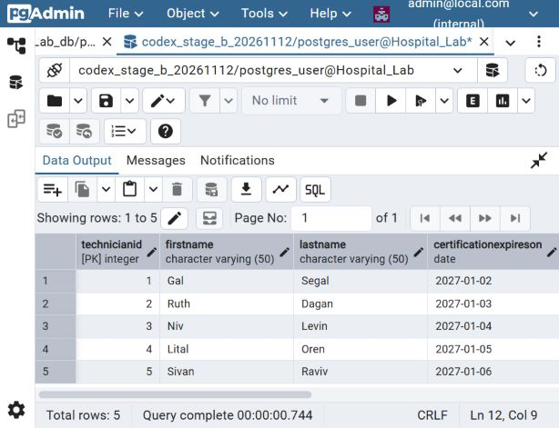

### Q7

תור הזמנות עם בדיקות ממתינות; סינון הזמנות שעומסן מעל הממוצע.

```sql
WITH pending AS (
 SELECT o.orderid,p.firstname,p.lastname,d.firstname AS doctor_firstname,
        d.lastname AS doctor_lastname,o.priority,o.orderedat,
        COUNT(*) AS pending_tests
 FROM testorder o JOIN patient p USING(patientid) JOIN doctor d USING(doctorid)
 JOIN labtest l USING(orderid)
 WHERE l.status IN ('Scheduled','InProgress')
 GROUP BY o.orderid,p.patientid,d.doctorid
)
SELECT * FROM pending WHERE pending_tests>=(SELECT AVG(pending_tests) FROM pending)
ORDER BY pending_tests DESC,orderedat,orderid;
```


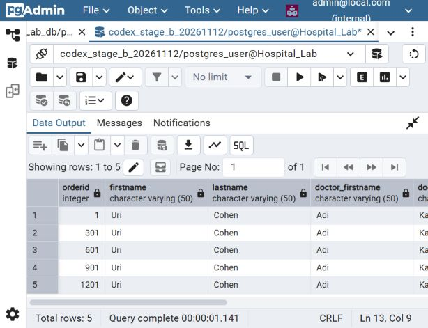

### Q8

דוח חריגות לפי רופא וקטגוריה; EXISTS מונע הכפלת תוצאות עם כמה התראות.

```sql
SELECT d.doctorid,d.firstname,d.lastname,tt.category,
       COUNT(*) AS abnormal_results,
       COUNT(DISTINCT o.patientid) AS patients,
       MAX(r.resultedat) AS latest_abnormal
FROM doctor d JOIN testorder o USING(doctorid) JOIN labtest l USING(orderid)
JOIN testtype tt USING(testtypeid) JOIN testresult r USING(labtestid)
WHERE r.isabnormal AND EXISTS (
 SELECT 1 FROM labalert a WHERE a.resultid=r.resultid AND a.status='Open'
)
GROUP BY d.doctorid,tt.category HAVING COUNT(*)>=2
ORDER BY abnormal_results DESC,d.doctorid,tt.category;
```

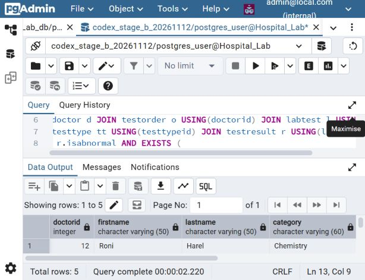


## DELETE ו-UPDATE

לכל הדגמה יש לצלם לפני הפעולה, להריץ BEGIN ואת הפעולה, לצלם RETURNING ואת הטבלה באותה טרנזקציה, ואז ROLLBACK. לכל פעולה יש פלט RETURNING לזיהוי הרשומות שנפגעו.

### D1

ניקוי התראות שטופלו לפני מועד הארכוב, רק אם הבדיקה הושלמה והתוצאה קיימת.

```sql
DELETE FROM labalert a USING testresult r,labtest l
WHERE a.resultid=r.resultid AND r.labtestid=l.labtestid
  AND a.status IN ('Acknowledged','Resolved')
  AND a.acknowledgedat<TIMESTAMP '2026-07-01' AND l.status='Completed'
RETURNING a.alertid,a.resultid,a.status,a.acknowledgedat;
```

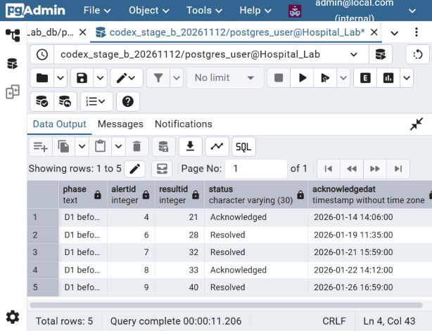


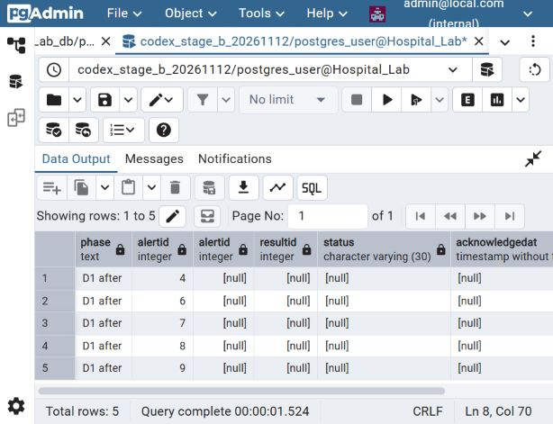

### D2

ניקוי בדיקות מתוכננות ישנות ללא תוצאה, רק בהזמנה המכילה בדיקה נוספת.

```sql
DELETE FROM labtest l USING testorder o
WHERE l.orderid=o.orderid AND l.status='Scheduled'
  AND o.orderedat<TIMESTAMP '2026-04-01'
  AND NOT EXISTS (SELECT 1 FROM testresult r WHERE r.labtestid=l.labtestid)
  AND EXISTS (SELECT 1 FROM labtest other
              WHERE other.orderid=l.orderid AND other.labtestid<>l.labtestid
                AND other.status<>'Scheduled')
RETURNING l.labtestid,l.orderid,l.status,l.scheduledat;
```


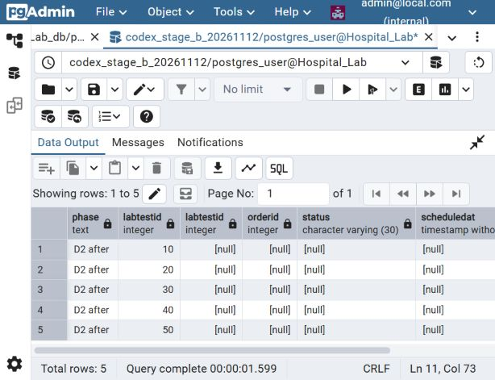

### D3

ניקוי רופאי הדגמה ללא הזמנות, כשההתמחות עדיין מיוצגת בידי רופא אחר.

```sql
DELETE FROM doctor d
WHERE d.licensenumber LIKE 'DEMO-LIC-%'
  AND NOT EXISTS (SELECT 1 FROM testorder o WHERE o.doctorid=d.doctorid)
  AND EXISTS (SELECT 1 FROM doctor active JOIN testorder o USING(doctorid)
              WHERE active.specialty=d.specialty AND active.doctorid<>d.doctorid)
RETURNING d.doctorid,d.firstname,d.lastname,d.specialty;
```


### U1

הסלמת עדיפות הזמנות עם התראות חמורות פתוחות; כלל הדגמה מנהלי.

```sql
UPDATE testorder o SET priority='STAT'
WHERE o.priority<>'STAT' AND EXISTS (
 SELECT 1 FROM labtest l JOIN testresult r USING(labtestid)
 JOIN labalert a USING(resultid)
 WHERE l.orderid=o.orderid AND r.isabnormal AND a.status='Open'
   AND a.severity IN ('High','Critical')
)
RETURNING o.orderid,o.patientid,o.doctorid,o.priority;
```


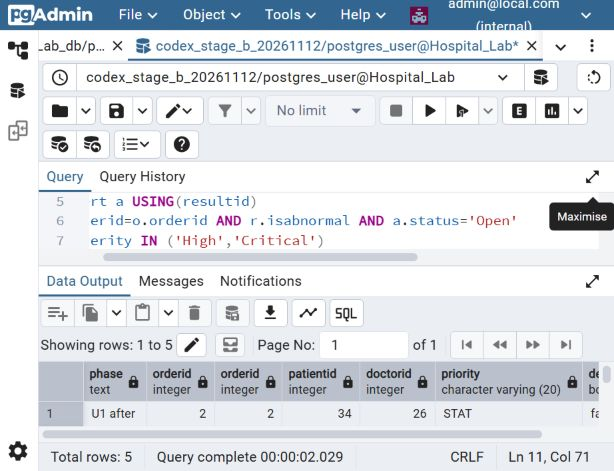


### U2

סגירת התראות מאושרות ישנות של בדיקות שהושלמו; הדגמת מדיניות ארכוב בלבד.

```sql
UPDATE labalert a SET status='Resolved'
FROM testresult r JOIN labtest l USING(labtestid) JOIN testorder o USING(orderid)
WHERE a.resultid=r.resultid AND a.status='Acknowledged'
  AND a.acknowledgedat<TIMESTAMP '2026-07-01'
  AND l.status='Completed' AND o.orderedat<r.resultedat
RETURNING a.alertid,a.resultid,a.status,a.acknowledgedat;
```

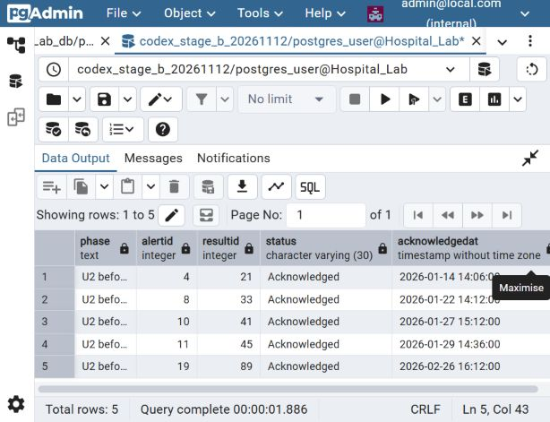


### U3

שיוך בדיקות מתוכננות לטכנאי בעל הסמכה בתוקף והעומס הנמוך ביותר.

```sql
WITH candidate AS (
 SELECT t.technicianid FROM labtechnician t LEFT JOIN labtest l USING(technicianid)
 WHERE t.certificationexpireson>=DATE '2026-11-12'
 GROUP BY t.technicianid
 ORDER BY COUNT(l.labtestid) FILTER (WHERE l.status IN ('Scheduled','InProgress')),
          t.technicianid LIMIT 1
)
UPDATE labtest l SET technicianid=c.technicianid
FROM candidate c,testorder o
WHERE l.orderid=o.orderid AND l.status='Scheduled' AND l.technicianid IS NULL
  AND o.priority IN ('Urgent','STAT')
RETURNING l.labtestid,l.orderid,l.status,l.technicianid;
```

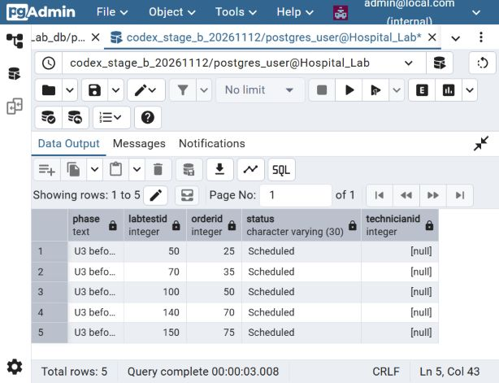


## אילוצים חדשים

שם לא ריק לרופא מונע ערך המכיל רווחים בלבד; סדר מועדי בדיקה מונע התחלה לפני התכנון והשלמה ללא התחלה או לפני ההתחלה; מועד אישור התראה אינו יכול להקדים את יצירתה. NULL במועד התחלה/תכנון מותר בהתאם לשלבי חיי הבדיקה, כפי שמפורט בביטוי CHECK. כל האילוצים נבדקים גם כנגד הרשומות הקיימות ב-ALTER TABLE.

```sql
-- הרצה פעם אחת לאחר שלב א׳ המעודכן/המיגרציה. שלושה אילוצים חדשים.
BEGIN;
ALTER TABLE doctor ADD CONSTRAINT chk_doctor_firstname_nonblank
 CHECK (length(btrim(firstname))>0);
ALTER TABLE labtest ADD CONSTRAINT chk_labtest_time_order
 CHECK ((startedat IS NULL OR scheduledat IS NULL OR startedat>=scheduledat)
    AND (completedat IS NULL OR (startedat IS NOT NULL AND completedat>=startedat)));
ALTER TABLE labalert ADD CONSTRAINT chk_labalert_ack_time
 CHECK (acknowledgedat IS NULL OR acknowledgedat>=createdat);
COMMIT;

-- שלוש ההכנסות הבאות נועדו להיכשל ב-23514 על שם האילוץ המתאים.
-- ב-pgAdmin: הריצו BEGIN+SAVEPOINT+INSERT עד לקבלת השגיאה,
-- ואז הריצו ROLLBACK TO SAVEPOINT ואחריו ROLLBACK בנפרד.
-- psql: לשם הרצת כל הקובץ השתמשו ב-ON_ERROR_STOP=off בחלק ההדגמות בלבד.
BEGIN;
SAVEPOINT invalid_doctor;
INSERT INTO doctor(doctorid,licensenumber,firstname,lastname,specialty)
VALUES(-900001,'DEMO-BAD-NAME','   ','Demo','Demo');
ROLLBACK TO SAVEPOINT invalid_doctor;
ROLLBACK;

BEGIN;
SAVEPOINT invalid_test;
INSERT INTO labtest(labtestid,status,scheduledat,startedat,completedat,orderid,testtypeid)
SELECT -900001,'Completed',TIMESTAMP '2026-01-02',TIMESTAMP '2026-01-01',
       TIMESTAMP '2026-01-03',o.orderid,tt.testtypeid
FROM testorder o CROSS JOIN testtype tt ORDER BY o.orderid,tt.testtypeid LIMIT 1;
ROLLBACK TO SAVEPOINT invalid_test;
ROLLBACK;

BEGIN;
SAVEPOINT invalid_alert;
INSERT INTO labalert(alertid,severity,message,createdat,status,acknowledgedat,resultid)
SELECT -900001,'Low','Invalid demonstration',TIMESTAMP '2026-02-02',
       'Acknowledged',TIMESTAMP '2026-02-01',resultid
FROM testresult ORDER BY resultid LIMIT 1;
ROLLBACK TO SAVEPOINT invalid_alert;
ROLLBACK;
```


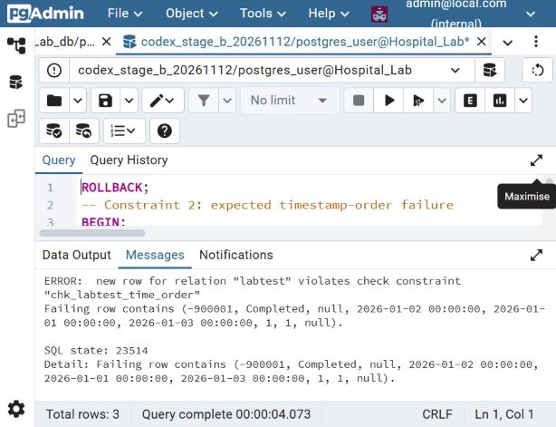


## ROLLBACK ו-COMMIT

הטבלה הזמנית שומרת את ערך Notes המקורי. restored בודק שוויון כולל NULL אחרי ביטול; persisted בודק שהסימון המדויק נשמר אחרי COMMIT. יש לוודא ששתי עמודות ההוכחה מחזירות true.

```sql
-- PostgreSQL / pgAdmin: הרצה על עותק ההדגמה בלבד.
-- נבחרת הזמנה קיימת; טבלה זמנית שומרת מצב קודם ומשמשת להוכחה מדויקת.
CREATE TEMP TABLE transaction_demo AS
SELECT orderid,notes AS old_notes FROM testorder ORDER BY orderid LIMIT 1;
SELECT 'before rollback' AS phase,o.orderid,o.notes FROM testorder o JOIN transaction_demo t USING(orderid);
BEGIN;
UPDATE testorder SET notes=COALESCE(notes,'')||' [ROLLBACK DEMO]'
WHERE orderid=(SELECT orderid FROM transaction_demo);
SELECT 'inside rollback' AS phase,o.orderid,o.notes FROM testorder o JOIN transaction_demo t USING(orderid);
ROLLBACK;
SELECT 'after rollback' AS phase,o.orderid,o.notes,
       o.notes IS NOT DISTINCT FROM t.old_notes AS restored
FROM testorder o JOIN transaction_demo t USING(orderid);

SELECT 'before commit' AS phase,o.orderid,o.notes FROM testorder o JOIN transaction_demo t USING(orderid);
BEGIN;
UPDATE testorder SET notes=COALESCE(notes,'')||' [COMMIT DEMO]'
WHERE orderid=(SELECT orderid FROM transaction_demo);
SELECT 'inside commit' AS phase,o.orderid,o.notes FROM testorder o JOIN transaction_demo t USING(orderid);
COMMIT;
SELECT 'after commit' AS phase,o.orderid,o.notes,
       o.notes IS NOT DISTINCT FROM COALESCE(t.old_notes,'')||' [COMMIT DEMO]' AS persisted
FROM testorder o JOIN transaction_demo t USING(orderid);
-- השינוי האחרון נשאר בכוונה לצורך הוכחת COMMIT.
DROP TABLE transaction_demo;
```


## אינדקסים וזמני ריצה

אינדקסים צורכים מקום ומייקרים INSERT/UPDATE/DELETE. PK/UNIQUE קיימים כבר יוצרים אינדקסים; שלושת האינדקסים החדשים מתמקדים בדפוסי סינון אחרים. פקודת ANALYZE מעדכנת סטטיסטיקות. ההשוואה מתבצעת על אותה שאילתה ובאותו אכלוס, ללא כפיית שימוש באינדקס. מדידה בודדת מושפעת מהמטמון; יש לחזור על הבדיקה ולהשוות חציונים.

```sql
-- על עותק בדיקה בלבד: DROP מסיר רק את שלושת האינדקסים בשמות של שלב ב׳.
-- אין לשנות enable_seqscan: המתכנן רשאי לבחור סריקה סדרתית.
-- יש להריץ מספר פעמים, להשוות חציון ו-BUFFERS, ולהביא בחשבון מטמון ועלות כתיבה.
ANALYZE;

-- idx_testorder_patient_date: חיפוש היסטוריית מטופל: מפתח מורכב לפי שוויון במטופל ואז טווח תאריכים ומיון.
DROP INDEX IF EXISTS idx_testorder_patient_date;
-- לפני
EXPLAIN (ANALYZE, BUFFERS)
SELECT o.orderid,o.orderedat,p.firstname,p.lastname,d.firstname AS doctor_firstname
FROM testorder o JOIN patient p USING(patientid) JOIN doctor d USING(doctorid)
WHERE o.patientid=17 AND o.orderedat>=TIMESTAMP '2026-01-01'
ORDER BY o.orderedat;
-- מדידה חוזרת בפועל, חציון 5 הרצות: לפני 0.637 ms; אחרי 0.189 ms.
CREATE INDEX idx_testorder_patient_date ON testorder(patientid,orderedat);
ANALYZE;
-- אחרי
EXPLAIN (ANALYZE, BUFFERS)
SELECT o.orderid,o.orderedat,p.firstname,p.lastname,d.firstname AS doctor_firstname
FROM testorder o JOIN patient p USING(patientid) JOIN doctor d USING(doctorid)
WHERE o.patientid=17 AND o.orderedat>=TIMESTAMP '2026-01-01'
ORDER BY o.orderedat;
-- אין הבטחה לשיפור: התוצאה נקבעת רק לפי המדידה בפועל.

-- idx_labtest_type_status: סינון לפי סוג בדיקה וסטטוס. הצירוף סלקטיבי יותר מכל סטטוס בפני עצמו.
DROP INDEX IF EXISTS idx_labtest_type_status;
-- לפני
EXPLAIN (ANALYZE, BUFFERS)
SELECT l.labtestid,tt.testname,l.status,o.orderid,o.orderedat
FROM labtest l JOIN testtype tt USING(testtypeid) JOIN testorder o USING(orderid)
WHERE l.testtypeid=25 AND l.status='Completed' ORDER BY l.labtestid;
-- מדידה חוזרת בפועל, חציון 5 הרצות: לפני 3.051 ms; אחרי 0.983 ms.
CREATE INDEX idx_labtest_type_status ON labtest(testtypeid,status);
ANALYZE;
-- אחרי
EXPLAIN (ANALYZE, BUFFERS)
SELECT l.labtestid,tt.testname,l.status,o.orderid,o.orderedat
FROM labtest l JOIN testtype tt USING(testtypeid) JOIN testorder o USING(orderid)
WHERE l.testtypeid=25 AND l.status='Completed' ORDER BY l.labtestid;
-- אין הבטחה לשיפור: התוצאה נקבעת רק לפי המדידה בפועל.

-- idx_labalert_open_created: אינדקס חלקי לתור התראות פתוחות בטווח תאריכים; קטן מאינדקס כל ההתראות.
DROP INDEX IF EXISTS idx_labalert_open_created;
-- לפני
EXPLAIN (ANALYZE, BUFFERS)
SELECT a.alertid,a.severity,a.createdat,r.isabnormal,l.labtestid
FROM labalert a JOIN testresult r USING(resultid) JOIN labtest l USING(labtestid)
WHERE a.status='Open' AND a.createdat>=TIMESTAMP '2026-06-01'
 AND a.createdat<TIMESTAMP '2026-06-08' ORDER BY a.createdat;
-- מדידה חוזרת בפועל, חציון 5 הרצות: לפני 0.841 ms; אחרי 0.522 ms.
CREATE INDEX idx_labalert_open_created ON labalert(createdat) WHERE status='Open';
ANALYZE;
-- אחרי
EXPLAIN (ANALYZE, BUFFERS)
SELECT a.alertid,a.severity,a.createdat,r.isabnormal,l.labtestid
FROM labalert a JOIN testresult r USING(resultid) JOIN labtest l USING(labtestid)
WHERE a.status='Open' AND a.createdat>=TIMESTAMP '2026-06-01'
 AND a.createdat<TIMESTAMP '2026-06-08' ORDER BY a.createdat;
-- אין הבטחה לשיפור: התוצאה נקבעת רק לפי המדידה בפועל.
```

### idx_testorder_patient_date

חיפוש היסטוריית מטופל: מפתח מורכב לפי שוויון במטופל ואז טווח תאריכים ומיון.

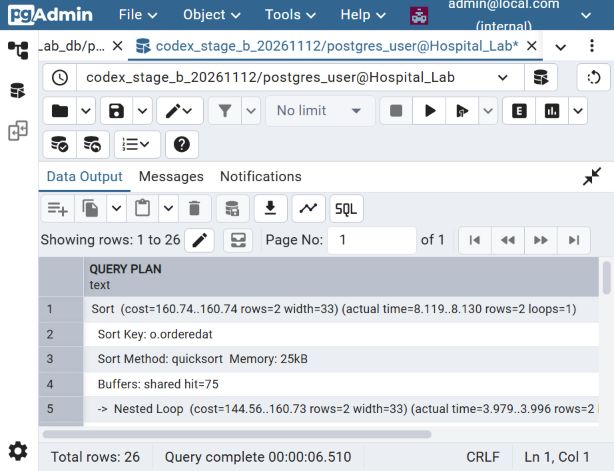

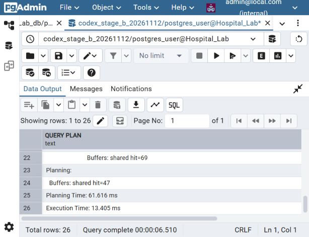

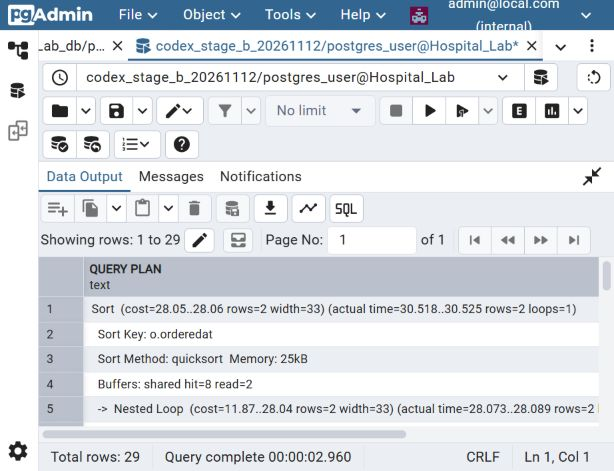


בצילומי pgAdmin: Execution Time לפני **13.405 ms**, ואחרי **51.333 ms**. במדידה זו זמן הריצה דווקא גדל למרות שינוי תוכנית הסריקה. האינדקס אינו מבטיח האצה; ההבדל מהמדידות החוזרות ממחיש השפעת מטמון ועומס.

### idx_labtest_type_status

סינון לפי סוג בדיקה וסטטוס. הצירוף סלקטיבי יותר מכל סטטוס בפני עצמו.


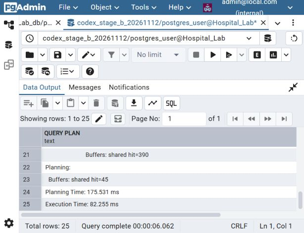


בצילומי pgAdmin: Execution Time לפני **82.255 ms**, ואחרי **6.719 ms**. במדידה זו זמן הריצה ירד. יש לקרוא זאת לצד סוג הסריקה ו-BUFFERS בצילום ותוצאות החזרות המופיעות בהמשך, ולא להסיק מכך יחס האצה קבוע.

### idx_labalert_open_created

אינדקס חלקי לתור התראות פתוחות בטווח תאריכים; קטן מאינדקס כל ההתראות.

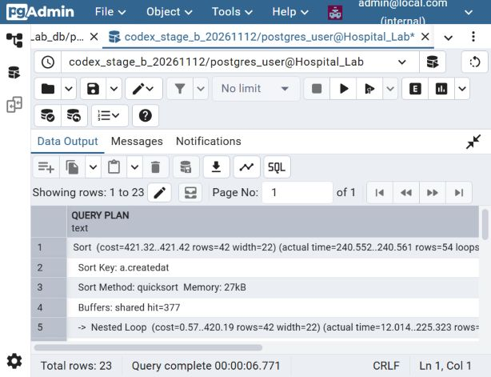


בצילומי pgAdmin: Execution Time לפני **249.162 ms**, ואחרי **54.932 ms**. במדידה זו זמן הריצה ירד. יש לקרוא זאת לצד סוג הסריקה ו-BUFFERS בצילום ותוצאות החזרות המופיעות בהמשך, ולא להסיק מכך יחס האצה קבוע.

## השלמת ההגשה

- [x] צילומי pgAdmin אמיתיים ל-SELECT, שינויים, אילוצים, טרנזקציות ואינדקסים; תוצאות SELECT הוגבלו לחמש שורות.
- [x] בדיקת שקילות ותוכניות ארבעת זוגות ה-SELECT, מדידה לכל דרך והסבר; חמש חזרות לפני ואחרי כל אינדקס.
- [x] יבוא ובדיקת התרשימים ב-ERDPlus, והפקת תמונות מלאות מהמקורות המאומתים. Download image באתר נכשל גם ידנית; אופן ההפקה המקומית מתועד.
- [x] גיבוי מעודכן בשם backup2 באמצעות pg_dump ובדיקת שחזור בעותק נפרד באותו מחשב.
- [x] שחזור backup2 במחשב אחר (המחשב של מוריה) — בוצע ב־15.11.2026 לפי [ההוראות](PullAndRestore.md); ראו [שחזור backup2 במחשב אחר](#שחזור-backup2-במחשב-אחר).
- [x] גרסת הגשת שלב ב׳ מרוכזת ב־main תחת TAG בשם `stage-b-2026-11-14`; פרסום הענף והתג נבדק מול השרת לאחר יצירת הגרסה.

אין לסמן סעיף כהושלם על בסיס Placeholder. יומני בדיקה בתיקיית audit הם ראיות הרצה, ואינם צילומי מסך של pgAdmin.


## תוצאות בדיקה בפועל — 12.11.2026

נבדק ב-PostgreSQL 16.15 בבסיס נפרד `codex_stage_b_20261112`. האכלוס כולל 66,657 רשומות בשמונה טבלאות; לפחות 500 בכל טבלה, 30,000 בדיקות ו-24,000 תוצאות. הבסיס המקורי `Hospiatl_Lab_db` לא שונה. תוצאות הבדיקות והדוגמאות נמצאות ב-[audit](audit/verification.json).

כל 12 מימושי ה-SELECT החזירו נתונים. ארבעת הזוגות הושוו בשני הכיוונים ב-EXCEPT ALL כדי לבדוק גם כפילויות. בדיקת Q4 האחרונה, לאחר הוספת מספר מטופלים וצירוף ההזמנות, נמצאת ב-[Q4_final_equivalence.txt](audit/Q4_final_equivalence.txt); הדוגמאות העדכניות הן [Q4A](audit/Q4A_final_samples.txt) ו-[Q4B](audit/Q4B_final_samples.txt). לשאר השאילתות ראו [דוגמאות עד חמש שורות](audit/03_select_samples.txt).

### מדידת ארבעת הזוגות

הטבלה מציגה זמן Execution Time של הרצה אחת לכל דרך, במילישניות. הזמנים אינם SLA ואין להסיק מהפרשים קטנים יתרון קבוע. האינדקסים החדשים כבר היו קיימים בעת מדידה זו. התוכניות המלאות עם BUFFERS נשמרו ב-audit בשם Q1A_plan.txt וכן הלאה.

| זוג | דרך A, ms | דרך B, ms | פירוש באכלוס הנוכחי |
|---|---:|---:|---|
| Q1 | 23.784 | 5024.153 | A מהירה משמעותית; B מבצעת ספירות מתואמות חוזרות. |
| Q2 | 11.944 | 19496.062 | A מהירה משמעותית; B חוזרת על צירופי הספירה לכל מטופל. |
| Q3 | 37.841 | 40.125 | A מהירה מעט במדידה זו; ההפרש קטן והמתכנן יכול לייעל NOT EXISTS. |
| Q4 | 30.692 | 31.239 | שקולות בפועל: אותן סריקות, אותו מיון ואותם 464 Buffers. A מהירה בכ־0.5 ms במדידה זו, הפרש של פחות מ־2% שהוא בתחום הרעש. B יעילה מעט יותר בתכנון: היא מחשבת את הממוצע ב־WindowAgg באותו מעבר, בעוד A סורקת את ה־CTE פעמיים (פעם לחישוב הממוצע ופעם לסינון), ולכן העלות המוערכת של B נמוכה במעט. |

### מדידות האינדקסים

חציון של חמש הרצות לפני וחמש אחרי כל אינדקס, עם ANALYZE ובלי לשנות enable_seqscan:

| אינדקס | לפני, ms | אחרי, ms | שינוי בתוכנית |
|---|---:|---:|---|
| idx_testorder_patient_date | 0.637 | 0.189 | Seq Scan על testorder הוחלף ב-Bitmap Index/Heap Scan. |
| idx_labtest_type_status | 3.051 | 0.983 | Seq Scan על labtest הוחלף ב-Index Scan. |
| idx_labalert_open_created | 0.841 | 0.522 | Seq Scan על labalert הוחלף ב-Bitmap Index/Heap Scan על האינדקס החלקי. |

במדידה הראשונה של אינדקס המטופל דווקא נרשמה האטה: 0.359 ms לפני לעומת 4.062 ms אחרי. זאת ראיה לכך שמדידה בודדת מושפעת ממטמון ותזמון; המדידה החוזרת הראתה חציון נמוך יותר אחרי יצירת האינדקס. גם במקרים האחרים אין לייחס כל הפרש בזמן לאינדקס לבדו; יש לקרוא את מספר הרשומות, סוגי הסריקה ונתוני BUFFERS. [מדידה ראשונה](audit/09_index_before_after.txt), [חמש החזרות המלאות](audit/10_repeated_index_plans.txt).

### שינויים, אילוצים וטרנזקציות

כל אחת משלוש המחיקות ושלושת העדכונים השפיעה על רשומות קיימות. לאחר ROLLBACK נבדקה התאמה מלאה של הטבלה למצבה הקודם בשני כיווני EXCEPT ALL. [יומן לפני/אחרי וביטול](audit/07_mutations.txt). שלוש ההכנסות השגויות נכשלו בקוד 23514 ועל שם האילוץ הנכון, ללא הפרת אילוץ אחר קודם לכן. [השגיאות הצפויות](audit/06_expected_errors.txt). בהדגמת הטרנזקציות התקבלו restored=true וגם persisted=true. [יומן הטרנזקציות](audit/08_transactions.txt).

### גיבוי ומיגרציה

[backup2.dump](backup2.dump) הוא גיבוי Custom של בסיס הבדיקה המעודכן, הכולל את האכלוס, שלושת האילוצים ושלושת האינדקסים ואת סימון COMMIT בשדה Notes. הוא שוחזר בהצלחה לבסיס `codex_stage_b_20261112_restore` באותו שרת. הושוו כל ערכי הרשומות באמצעות טביעות MD5 מסודרות, מטא־דאטה עמודות, הגדרות האינדקסים, מבנה האילוצים וההגדרות המדויקות של שלושת האילוצים החדשים. [השוואת השחזור](audit/13_restore_comparison.txt), [בדיקת נפחים וקשרים בשחזור](audit/11_backup2_restore.txt).

pg_dump/pg_restore כתבו מחדש ביטויי cast של מערכי VARCHAR באילוצי IN הישנים. לכן השוואת מחרוזת של pg_get_constraintdef לבדה הציגה הבדל תחבירי. ההבדל תועד ב-[catalog_diff.txt](audit/catalog_diff.txt); האילוצים החדשים והאינדקסים נמצאו זהים, ובדיקות הנתונים והקטלוג עברו.

StageA_Migration.sql הורץ על עותק נפרד של הבסיס המקורי. נבדק שכל העמודות הקודמות נשמרו ללא שינוי ושתאריכי ההסמכה החדשים זהים לתאריכים בהקמה מאפס. [יומן המיגרציה](audit/14_migration.txt), [שימור הרשומות המקוריות](audit/15_preserved_original_rows.txt).

SHA-256 של backup2.dump:

```text
6fcacd9ef01f0bad38d48ff35348453af207af81723bd78855ac054150ff6a98
```

צילומי pgAdmin נוספו לאחר חידוש החיבור דרך הדפדפן הפנימי. הם צילומי ממשק אמיתיים ולא תמונות של יומני CLI. ייבוא ובדיקת המקורות והפקת תמונות מלאות הושלמו. שחזור backup2 במחשב אחר בוצע ב־15.11.2026; ראו הסעיף בסוף הדוח. גרסת ההגשה מסומנת בתג `stage-b-2026-11-14`. ההורדה המקורית מהאתר נכשלה, והתמונות הופקו מקומית כאמור לעיל.

בתיעוד המחיקות נשמרו חמישה מזהים בטבלה זמנית לפני הפעולה. לאחר הפעולה אותם מזהים הוצגו בצירוף חיצוני לטבלה הנוכחית: NULL ו-deleted=true מוכיחים שהרשומות נמחקו. בעדכונים אותן רשומות הוצגו עם הערכים החדשים. כל פעולה בוטלה ב-ROLLBACK. בהדגמת COMMIT נוסף הסימון UI COMMIT DEMO, נשמר ונבדק persisted=true, ואז בטרנזקציה נפרדת הוחזר Notes למצבו שלפני הדגמת הממשק. קובץ RollbackCommit.sql המקורי משאיר את סימון COMMIT DEMO בכוונה.

שלושת ALTER TABLE הודגמו בטרנזקציה נפרדת לאחר הסרה זמנית של אותם שלושה אילוצים בעותק הבדיקה; לאחר הצילום בוטלה הטרנזקציה ונשארו האילוצים המקוריים של שלב ב׳. בדיקות הכישלון הורצו לאחר הביטול ונכשלו על האילוצים הקיימים.

צילומי האינדקסים מציגים מדידות נוספות דרך הממשק, בתנאי עומס אחרים מהמדידה החוזרת. לאחר כל זוג בוטלה הטרנזקציה, ולכן נשארו שלושת האינדקסים כפי שהיו לפני התיעוד. המועדים בשאילתות קבועים. בדיקת הסיום בממשק אישרה 30,000 בדיקות, 24,000 תוצאות ושלושה אינדקסים חדשים.


מגבלת הצילום: רוחב הדפדפן היה 614 פיקסלים, ולכן בחלק מהתמונות נראות רק העמודות השמאליות. קוד השאילתה ופלטי הבדיקה הטקסטואליים כוללים את יתר העמודות. אין לראות בתמונה החתוכה הוכחה לכל עמודה שאינה גלויה.

## שחזור backup2 במחשב אחר

בוצע ב־15.11.2026 במחשב של מוריה, שאינו המחשב שבו נוצר backup2, ב־PostgreSQL 16.15 וב־pgAdmin 4 (גרסה 9.18) המותקנים בו ב־Docker. קובץ backup2.dump נלקח מתג ההגשה `stage-b-2026-11-14`, וטביעת ה־SHA-256 שלו זהה לערך המתועד לעיל.

שלבי השחזור, לפי [PullAndRestore.md](PullAndRestore.md):

1. נוצר בסיס נתונים חדש וריק בשם `stage_b_partner_restore_20261114`.
2. Restore מתפריט pgAdmin: פורמט Custom, הקובץ backup2.dump, וב־Data Options סומנו Do not save Owner ו־Privileges. התהליך הסתיים בהודעה Successfully completed.
3. ב־Query Tool על הבסיס המשוחזר הורצו בדיקות [PartnerValidation.sql](PartnerValidation.sql) (ללא שורת `\set` של psql): ספירות שמונה הטבלאות זהות לטבלה ב־PullAndRestore.md, והתקבלה ההודעה PASS, כלומר שני שדות ה־DATE, שלושת האילוצים ושלושת האינדקסים קיימים.


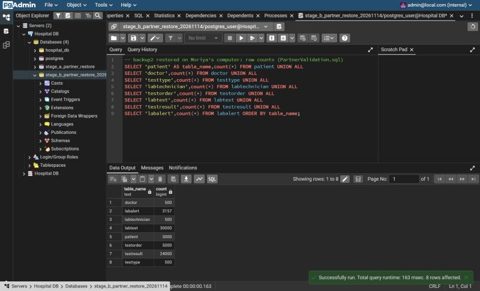


