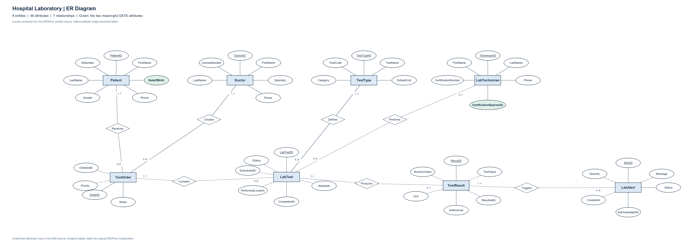
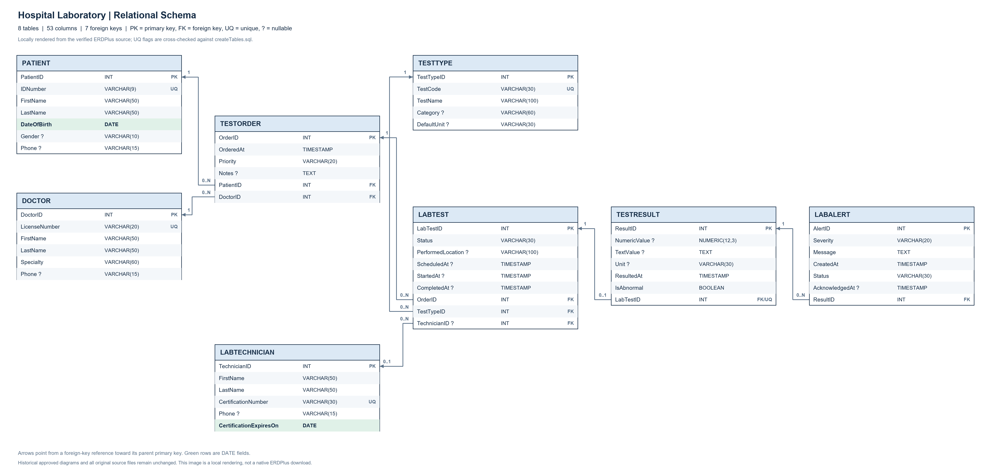

# תרשימים מעודכנים — קבצים מלאים

## התרשימים המלאים המעודכנים

קובצי המקור יובאו ונבדקו ב-ERDPlus. לאחר שגם המשתמשת דיווחה שהורדה ידנית באמצעות Download image נכשלת, נוצרו התמונות הבאות מקובצי המקור המאומתים באמצעות מחולל מקומי. **אלה תמונות מלאות של המודל המעודכן, ולא צילומי מסך או הורדות PNG מקוריות מהאתר.** פריסת הרכיבים הורחבה לשיפור הקריאות; הישויות, השדות, המפתחות והקשרים נשמרו. התמונות הישנות של שלב א׳ נשמרו ללא שינוי ואינן מייצגות את העמודה החדשה.

### ERD מעודכן

התרשים כולל שמונה ישויות, 46 מאפיינים ושבעה קשרים. שני מאפייני DATE משמעותיים מודגשים בירוק. קו תוקף ההסמכה מחובר ישירות לטכנאי, ומיקומו שונה בתצוגה המקומית כדי שלא יחצה את מאפיין המפתח. ריבוי הקשרים נשמר מהמקור שנבדק באתר.

[PNG ברזולוציה מלאה](updated-erd.png) · [JPEG](updated-erd.jpeg) · [SVG וקטורי](updated-erd.svg) · [מקור ERDPlus](ERD-revised.erdplus)

### DSD מעודכן

התרשים מציג את כל שמונה הטבלאות, 53 העמודות ושבעת המפתחות הזרים, לרבות טיפוסים, אורכי מחרוזות, אפשרות NULL, מפתחות ראשיים וייחודיות. TechnicianID בבדיקה הוא אופציונלי, ולכן מסומן 0..1 בצד הטכנאי; LabTestID בתוצאה ייחודי, ולכן נשמר הקשר 1 מול 0..1 בין בדיקה לתוצאה. UQ נבדק מול createTables.sql. התמונות נבדקו חזותית לאחר יצירתן.

[PNG ברזולוציה מלאה](updated-dsd.png) · [SVG וקטורי](updated-dsd.svg) · [מקור ERDPlus סופי](DSD-stage-b-verified.erdplus)

יצירה חוזרת: `python audit/render_verified_diagrams.py`. רישום תכולה, ספירות ו-SHA-256 נמצא ב-[local_diagram_rendering.json](../audit/local_diagram_rendering.json). אין צורך להמשיך לנסות את כפתור ההורדה לצורך צפייה בתמונות האלה. אם תידרש דווקא הורדה מקורית מהאתר, התקלה בכפתור נותרה פתוחה ויש לבדוק אותה בדפדפן אחר או מול האתר.

פקודת Download image נכשלה דרך כלי השליטה וגם בלחיצה ידנית של המשתמשת. לכן נוצרו תמונות מלאות מקומית מקובצי המקור שאומתו באתר; הן מוצגות בסעיף התרשימים המלאים להלן, עם ציון אופן הפקתן. הצילומים הבאים נשמרו כראיות לבדיקה באתר בלבד.
